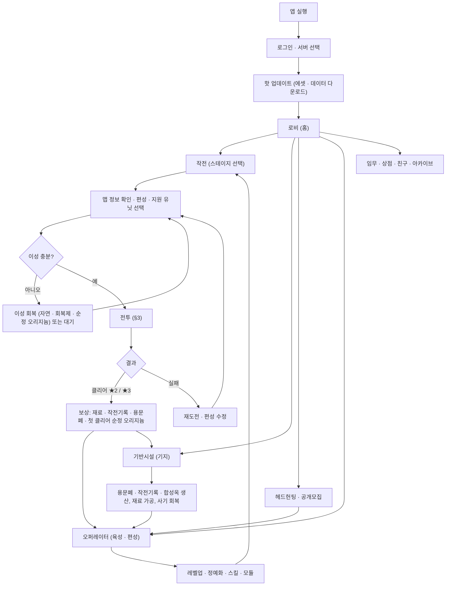
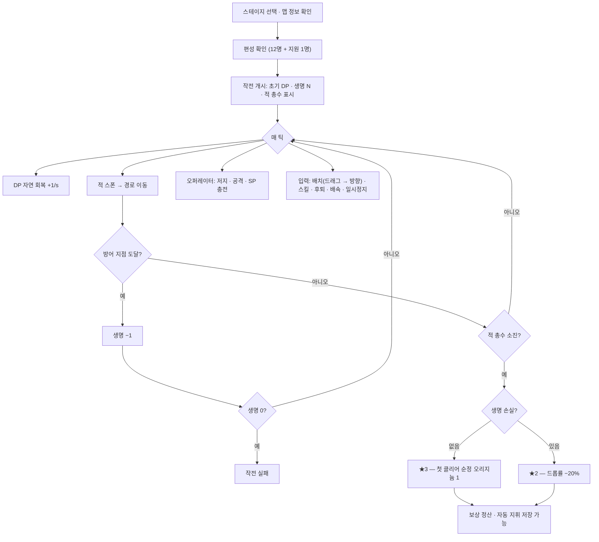
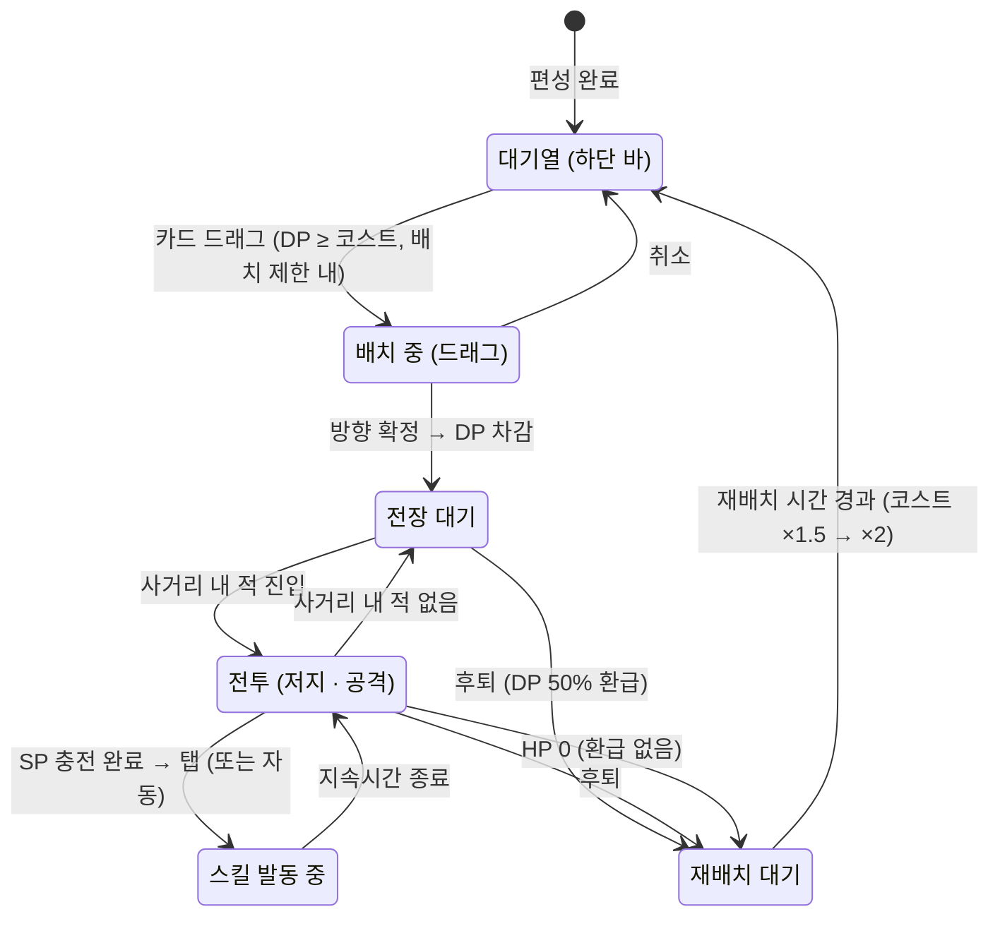
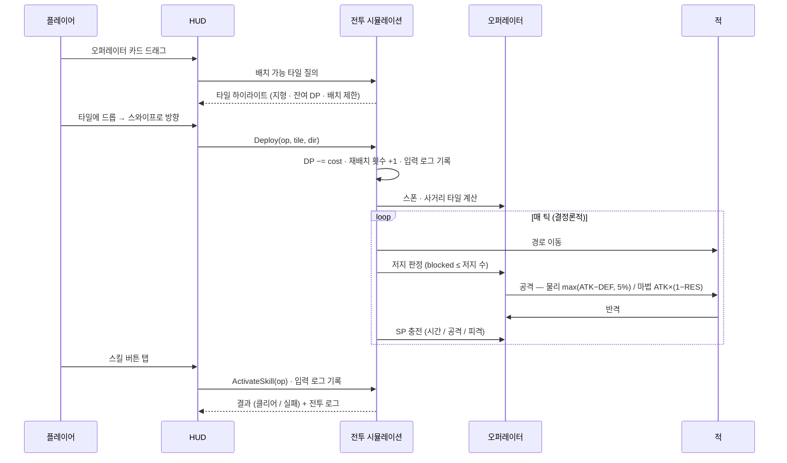
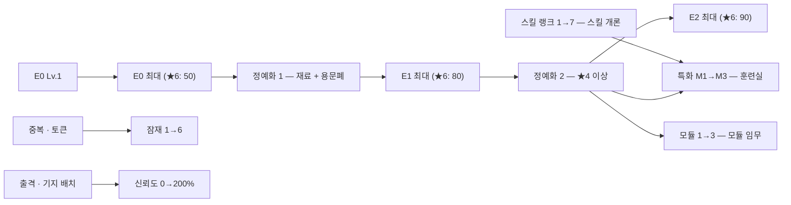
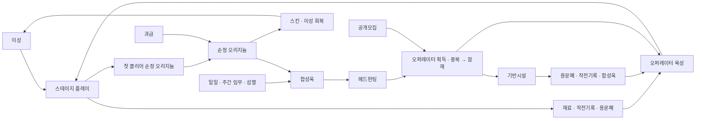
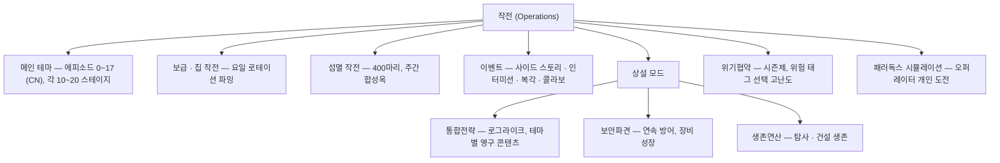
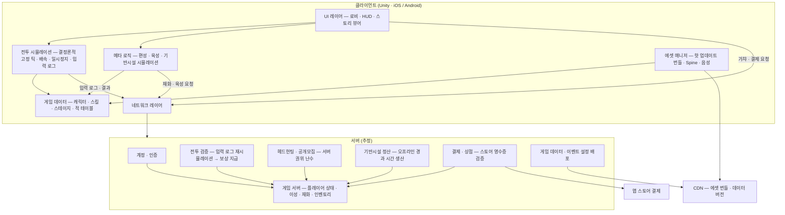
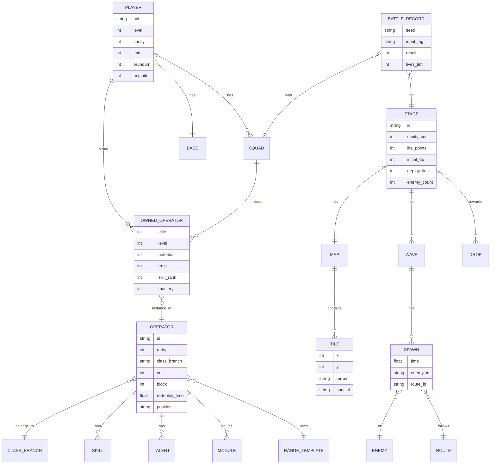

# 01. 벤치마킹 — 명일방주 (Arknights)

> 목적: ARMY OF ONE(가칭)의 "게임 진행 방식을 명일방주와 최대한 유사하게" 하기 위해, 명일방주의 특징 · 플레이 방식 · 시스템 구조를 분해하고, 우리 게임에 **가져올 것 / 바꿀 것 / 뺄 것**을 정한다(§11).
> 기준: 글로벌 · 한국 서버, 2026-11 시점. 수치는 Arknights Terra Wiki(arknights.wiki.gg) · GamePress 검색 결과로 교차 확인한 값이며, 직접 확인하지 못한 항목은 **(미확인)** 으로 표시했다. 아키텍처(§10)는 공개된 동작으로부터 **추정**한 것이다.
> 작성일: 2026-11-03 · 선행 문서: [00 컨셉 제안서](00_컨셉_제안서.md)

---

## 1. 개요

| 항목 | 내용 |
| :--- | :--- |
| 개발 / 퍼블리싱 | Hypergryph(중국) / Yostar(글로벌 · 일본 · 한국) |
| 출시 | 2019-05 중국, 2020-01 글로벌 · 한국 |
| 엔진 · 플랫폼 | Unity, iOS / Android, Landscape 고정 |
| 장르 | 타워 디펜스(배치 퍼즐형) + 캐릭터 수집 · 육성 RPG + 기지 경영 |
| 과금 모델 | F2P + 가챠(헤드헌팅) + 월간 카드 + 스킨 + 패키지 |
| 아트 | 2D 일러스트(일러스트레이터 다수) + 전투 SD 스프라이트(Spine) + 고정 탑다운 2.5D 맵 |

### 1.1 정체성 세 가지
1. **배치 퍼즐형 TD.** 유닛은 한 번 배치하면 자리를 지킨다. 지형(지상 / 고지대) · 방향 · 저지 수 · 사거리 모양이 결합해 "어디에, 어느 방향으로, 언제"가 퍼즐이 된다. 밸런스를 수치 인플레이션보다 **레벨 디자인**으로 푼다.
2. **수집 · 육성.** 가챠로 얻은 오퍼레이터를 스테이지 드랍 재료와 기지 생산물로 키운다. 육성 깊이(정예화 · 스킬 특화 · 모듈 · 잠재 · 신뢰도)가 장기 리텐션의 축이다.
3. **텍스트 중심 세계관.** 테라 · 오리지늄 · 감염자라는 무거운 설정과 긴 스토리. 전투와 스토리가 분리되어 있어 전투 부담 없이 읽을 수 있다.

### 1.2 왜 벤치마크하는가
- 전투 규칙이 명료해 **설명 없이 배울 수 있고**, 명일방주 경험자가 많아 우리 게임의 온보딩 비용을 낮춘다.
- 결정론적 전투 → **리플레이(자동 지휘) · 서버 검증 · 연습 모드**가 한 구조에서 나온다(§10).
- 라이브 콘텐츠 포맷(이벤트 · 섬멸 · 위기협약 · 로그라이크)이 **정형화**되어 있어 운영 설계를 그대로 참조할 수 있다.

---

## 2. 플레이어 여정

- **세션 단위**: 로비 → 스테이지 1~3개 → 보상으로 육성 → 기지 수거 → 종료. 한 세션 10~20분.
- **일일 단위**: 일일 임무 · 기지 수거 · 보급 작전(요일 로테이션) · 공개모집 갱신.
- **주간 단위**: 주간 임무 · 섬멸 작전 합성옥 상한 · 이벤트 진행.

---

## 3. 전투 시스템

### 3.1 전장 구성

| 타일 | 역할 | 비고 |
| :--- | :--- | :--- |
| 지상 (Ground) | 근접 오퍼레이터 배치, 적이 지나가는 길 | 저지가 일어나는 곳 |
| 고지대 (High ground) | 원거리 오퍼레이터 배치 | 적이 지나가지 않음, 높이 차로 표현 |
| 배치 불가 | 벽 · 구조물 · 물 | 시야 · 사거리 계산에는 포함 |
| 출현 지점 (붉은 상자) | 적 스폰 | 복수 가능 |
| 방어 지점 (파란 상자) | 적이 도달하면 생명 −1 | 복수 가능 |
| 특수 타일 | 구멍(밀치면 즉사), 수풀(원거리 적 표적 불가), 가속 · 감속, 폭발물, 엘리베이터 등 | 이벤트마다 신규 기믹 추가 |

- 맵은 고정 카메라의 2.5D 격자. 통상 가로 9~13 × 세로 5~8 타일. 배치 모드에서 격자와 **배치 가능 타일**이 강조되고, 배치 전 **사거리 미리보기**가 보인다.
- 스테이지 진입 전 **맵 정보** 화면에서 적 목록(능력치 포함) · 적 총수 · 경로 미리보기를 볼 수 있다.

### 3.2 배치 자원 (DP, Deployment Point)

| 규칙 | 값 |
| :--- | :--- |
| 초기 DP | 스테이지별 지정 (대개 10 전후) |
| 자연 회복 | 기본 1 DP / 1초. 스테이지 조건으로 2초당 1 · 3초당 1로 느려지거나 금지되기도 함. DP가 0 미만이면 회복 −50% |
| 상한 | 99 |
| 추가 생산 | 선봉 직군 스킬(시간당 생산 · 저지 시 생산 · 처치 시 회복 등) |
| 소모 | 배치 시 오퍼레이터 코스트만큼 차감 |
| 후퇴 환급 | **현재 코스트의 50% (내림)**. 예외: 돌격병(Charger)은 기본 코스트 전액 환급, 상인(Merchant)은 환급 없음 |
| 재배치 코스트 | 1회 재배치 시 **×1.5**, 2회째부터 **×2** (상한 99) |

DP는 명일방주의 **시간 자원**이다. "지금 비싼 유닛을 낼지, 기다렸다가 둘을 낼지"가 초반 운영의 핵심이며, 선봉 직군이 이 경제를 가속한다.

### 3.3 배치 · 후퇴 · 재배치

| 단계 | 조작 | 규칙 |
| :--- | :--- | :--- |
| 배치 | 하단 바에서 카드를 타일로 드래그 → 드롭 후 **스와이프로 4방향** 지정 | 지형(지상 / 고지대)과 DP, **배치 제한 수**를 만족해야 함 |
| 후퇴 | 전장의 오퍼레이터 탭 → 후퇴 버튼 | DP 일부 환급, 재배치 대기 시작 |
| 전투 불능 | HP 0 | 후퇴와 동일하게 재배치 대기, 환급 없음 |
| 재배치 대기 | 오퍼레이터별 고정값 (대개 70초, 쾌속 재배치 특수 직군은 18초 전후) | 대기 후 코스트가 올라간 상태로 재배치 |
| 배치 제한 | 스테이지별 "동시 배치 가능 수" | 편성 12명 중 전장에는 제한 수만큼만 |

### 3.4 오퍼레이터 전투 속성

| 속성 | 설명 |
| :--- | :--- |
| HP / ATK / DEF / RES | 체력 / 공격력 / 물리 방어 / 마법 저항(%) |
| 공격 간격 | 초 단위, 직군 · 분기별 고정 |
| 저지 수 | 동시에 막을 수 있는 적 수 (0~3, 일부 스킬로 증가) |
| 사거리 | 타일 모양 템플릿. 정예화로 확장되는 경우 다수 |
| 코스트 / 재배치 시간 | DP 소모 / 대기 초 |
| 재능 (Talent) | 패시브 1~2개, 정예화로 해금 · 강화 |
| 스킬 | 1~3개 (§3.5) |
| 표적 우선순위 | 기본: **방어 지점에 가장 가까운 적**(먼저 샐 적). 저지 중인 적 우선, 대공 우선, 최저 HP 우선 등 직군별 예외 |

### 3.5 스킬 (SP 시스템)

| 축 | 종류 |
| :--- | :--- |
| SP 충전 | **자연 회복**(초당 1) / **공격 회복**(공격 시 1) / **피격 회복**(피격 시 1) |
| 발동 | **수동**(SP 충전 후 탭) / **자동**(충전 즉시) / 패시브 |
| 형태 | 지속시간형 / 즉발형 / 탄약(횟수)형 / 영구형 |
| 초기 SP | 스킬별 지정, 배치 직후 일부 충전 상태로 시작 |

스킬 하나가 오퍼레이터의 정체성이다. "언제 누르느냐"가 플레이어 숙련의 핵심이며, 자동 지휘(리플레이)가 성립하는 이유도 발동 시점이 입력으로 기록되기 때문이다.

### 3.6 적과 대미지 공식

| 항목 | 규칙 |
| :--- | :--- |
| 적 속성 | HP · ATK · DEF · RES · 이동 속도 · 중량(밀치기 · 당기기 저항) · 공중 여부 · 특수 능력 |
| 공중 적 | 저지 불가, 지상 근접 오퍼레이터의 표적이 되지 않음(대공 가능 직군만) |
| 물리 대미지 | `max(ATK − DEF, ATK × 5%)` |
| 마법 대미지 | `max(ATK × (1 − RES/100), ATK × 5%)` |
| 고정 대미지 | 방어 · 저항 무시 |
| 생명 | 적이 방어 지점에 도달하면 −1. 0이면 실패 |
| 웨이브 | 시간 기반 스폰 테이블. "적 N / 총 M" 카운터로 진행도 표시 |

### 3.7 승패 · 평가 · 모드

| 항목 | 규칙 |
| :--- | :--- |
| 클리어 | 적 총수를 모두 처리(처치 또는 통과)하고 생명이 남아 있음 |
| ★3 | 생명 손실 없이 클리어 |
| ★2 | 생명 손실이 있으나 클리어. **드롭률 −20%** |
| ★4 | 챌린지 모드 / 악조건(Adverse Environment) 모드 클리어 |
| 실패 | 생명 0. 평가 없음 |
| 첫 클리어 보상 | ★3 · ★4 첫 클리어 시 각각 순정 오리지늄 1 |
| 배속 · 일시정지 | 2배속, 일시정지 중 배치 · 스킬 가능 |
| 연습 모드 | 연습권(Drill Plan) 소모 — 구 시스템 기준 일 30개 상한. 이성 소모 · 보상 · 임무 진행 없음 |
| 자동 지휘 | ★3 클리어 기록을 저장해 재생. 전투가 결정론적이라 동일 결과 보장 |
| 난이도 | 일반 / 챌린지(구 챕터) / 악조건(에피소드 9 이후) / 극한(일부) |

### 3.8 스테이지 진행 흐름

### 3.9 오퍼레이터 전투 상태

### 3.10 전투 틱 시퀀스

---

## 4. 직군 체계

| 직군 | 위치 | 역할 | 대표 분기 (예) |
| :--- | :--- | :--- | :--- |
| 선봉 (Vanguard) | 지상 | DP 생산, 초반 저지 | 개척자(스킬로 DP), 돌격병(처치 시 DP, 후퇴 시 전액 환급), 기수, 전술가, 요원 |
| 근위 (Guard) | 지상 | 근접 딜러 | 전함, 백부장, 영주(원거리 공격 가능), 교관, 검객, 투사, 술사형, 해방자, 무사 |
| 중장 (Defender) | 지상 | 저지 3, 고방어 | 철벽, 수호자(치유), 거신, 술사형, 결투가, 요새(원거리), 감시병 |
| 저격 (Sniper) | 고지대 | 원거리 물리, 대공 | 속사수, 중포수, 포격수, 신사수, 산탄수, 투척수, 공성수 |
| 술사 (Caster) | 고지대 | 마법 대미지 | 핵심, 확산, 폭발, 연쇄, 밀집, 신비, 기계 |
| 의료 (Medic) | 고지대 | 치유 | 단일, 다중, 치료사(범위), 유랑, 주술, 연쇄 |
| 보조 (Supporter) | 고지대 | 감속 · 약화 · 버프 · 소환 | 감속, 주술사(약화), 음유시인, 수호자, 소환사, 공예가 |
| 특수 (Specialist) | 지상 / 고지대 | 쾌속 재배치, 밀치기 · 당기기, 함정, 변칙 | 처형자(쾌속), 밀치기, 갈고리, 매복, 인형사, 상인, 함정사, 괴짜 |

- 분기(서브클래스)마다 **공격 방식 · 사거리 · 저지 수 · 코스트 · 재배치 시간**의 템플릿이 다르다. 분기가 곧 "전장에서 하는 일"이다.
- 희귀도 ★1~6. 스킬 수: ★3 1개, ★4~5 2개(2번째는 정예화 1에서 해금), ★6 3개(3번째는 정예화 2에서 해금).

---

## 5. 오퍼레이터 수집 · 육성

### 5.1 획득 경로

| 경로 | 재화 | 특징 |
| :--- | :--- | :--- |
| 헤드헌팅 (가챠) | 합성옥 600 / 1회, 헤드헌팅 허가증 | ★6 2% (★5 8% · ★4 50% · ★3 40%는 미확인). 50회 미획득 후 1회마다 +2%, 100%까지. 천장 카운터는 픽업 외 ★6으로도 초기화. 신규 배너 10회 내 ★5 이상 보장(미확인). 한정 배너는 300회 스파크 |
| 공개모집 | 공개모집 허가증 | 제시된 태그 5개 중 최대 3개 선택 + 모집 시간(1~9시간)으로 희귀도 범위 결정. 9시간이면 "상급 오퍼레이터(★6 보장)" · "엘리트 오퍼레이터(★5 보장)" 태그가 탈락하지 않음. 긴급 소집권으로 즉시 완료(결과 동일) |
| 이벤트 · 상점 | 이벤트 재화, 증서 | 이벤트 보상 ★5, 증서 교환 ★5~6 |
| 스토리 · 임무 | — | 초반 지급 오퍼레이터 |
| 중복 | — | 잠재 토큰으로 전환 (잠재 1→6) |

### 5.2 육성 단계

| 단계 | 재화 · 조건 | 효과 |
| :--- | :--- | :--- |
| 레벨 | 작전기록(EXP) + 용문폐 | 능력치 |
| 정예화 (E0→E1→E2) | 재료 + 용문폐, E2는 ★4 이상만 | 레벨 상한 · 사거리 · 재능 · 스킬 해금 · 일러스트 변경 |
| 스킬 랭크 1→7 | 스킬 개론 + 재료 | 스킬 수치 |
| 스킬 특화 M1→M3 | 랭크 7 + E2 + 훈련실(시간 소요) | 스킬 수치 최종 단계 |
| 잠재 1→6 | 중복 · 잠재 토큰 | 코스트 −1, 재배치 −, HP · ATK +, 재능 강화 |
| 신뢰도 0→200% | 출격 · 기반시설 배치 | 100%까지 능력치 보너스, 그 이상은 파일 · 대사 해금 |
| 모듈 (1→3단계) | E2 Lv.40(★4) / 50(★5) / 60(★6) + 모듈 임무 + 모듈 데이터 블록 | 능력치 · 재능 · 분기 특성 변경 |

| 희귀도 | E0 최대 | E1 최대 | E2 최대 |
| :-: | :-: | :-: | :-: |
| ★1~2 | 30 | — | — |
| ★3 | 40 | 55 | — |
| ★4 | 45 | 60 | 70 |
| ★5 | 50 | 70 | 80 |
| ★6 | 50 | 80 | 90 |

### 5.3 육성 경로

- 육성 비용은 희귀도에 비례해 가파르다. "★6 한 명을 E2 Lv.90 M3까지"가 한 달 단위 목표가 되도록 설계되어 있다.
- 신규 유저 온보딩은 **★3~4 저코스트 육성**이 효율적이라는 메타가 형성되어 있고, 이것이 저희귀도 캐릭터의 존재 이유다.

---

## 6. 메타 시스템

### 6.1 이성 (Sanity, 스태미너)

| 항목 | 값 |
| :--- | :--- |
| 최대치 | 박사 레벨에 따라 증가. 레벨 상한 120에서 135. 이후 업데이트로 +45 추가 상향(글로벌 적용 시점 미확인) |
| 자연 회복 | 6분당 1 (하루 240) — 통설, 위키 직접 미확인 |
| 소모 | 메인 스테이지 6~21, 섬멸 25, 이벤트 스테이지 다양 |
| 회복 수단 | 이성 회복제(임무 · 이벤트 보상), 순정 오리지늄 1개당 135 회복(일일 횟수 제한 폐지) |
| 실패 시 | 실패 · 포기 시 이성 환급(섬멸 작전은 확인, 일반 스테이지는 통설 — 미확인). 전투 중 앱 종료는 실패 처리 |

이성은 메인 스토리 진행보다 **재료 파밍 속도**를 제한하는 장치다. 스토리 자체는 이성을 모아 두면 하루에 챕터 하나를 끝낼 수 있다.

### 6.2 재화 체계

| 재화 | 획득 | 용도 |
| :--- | :--- | :--- |
| 용문폐 (LMD) | 스테이지, 교역소, 임무 | 모든 육성 비용 |
| 작전기록 (EXP) | 스테이지, 제조소 | 레벨업 |
| 재료 (티어 1~5) | 스테이지 드랍, 가공소 합성 | 정예화 · 스킬 · 모듈 |
| 합성옥 (Orundum) | 일일 · 주간 임무, 섬멸(주간 상한), 교역소, 순정 오리지늄 변환(1 → 180) | 헤드헌팅 600 / 1회 |
| 순정 오리지늄 (OP) | 첫 클리어 ★3 · ★4, 과금 | 합성옥 변환, 이성 회복, 스킨, 패키지 |
| 헤드헌팅 허가증 | 임무 · 이벤트 · 상점 | 헤드헌팅 1회 |
| 공개모집 허가증 | 임무 · 상점 | 공개모집 1회 |
| 증서 (황 · 녹) | 중복 오퍼레이터 | 상점 교환(오퍼레이터 · 재료 · 허가증) |
| 이벤트 재화 | 이벤트 스테이지 | 이벤트 상점 |

### 6.3 기반시설 (기지)

| 시설 | 기능 |
| :--- | :--- |
| 제어 센터 | 시설 레벨 상한, 전체 버프 |
| 교역소 | 금괴 → 용문폐 / 합성옥 주문 |
| 제조소 | 금괴 · 작전기록 · 오리지늄 조각 생산 |
| 발전소 | 전력 공급, 드론(가속) 충전 |
| 숙소 | 사기 회복 |
| 응접실 | 단서 수집 · 친구 방문 → 보상 |
| 가공소 | 재료 합성, 부산물 |
| 훈련실 | 스킬 특화 |
| 사무실 | 공개모집 슬롯 · 태그 갱신 |

- 오퍼레이터는 **사기**(0~24)를 소모하며 시설에서 일하고 숙소에서 회복한다. 오퍼레이터마다 기지 스킬이 달라 "전투 외 가치"가 생긴다.
- 하루 2~3회 수거하는 방치형 루프. 접속 동기의 큰 축이지만 **시스템 규모가 크다**(시설 9종 × 레벨 × 오퍼레이터 기지 스킬 수백 개).

### 6.4 임무 · 보급

| 구분 | 내용 |
| :--- | :--- |
| 일일 임무 | 스테이지 n회, 기지 수거, 공개모집 등 → 합성옥 · 재료 |
| 주간 임무 | 누적 이성 소모, 섬멸 등 → 합성옥 · 허가증 |
| 보급 작전 | 요일별 개방: 용문폐 · 작전기록 · 스킬 개론 · 직군 칩 · 탄소 등 |
| 섬멸 작전 | 400마리 방어, 주간 합성옥 상한까지 반복 보상 |

### 6.5 코어 루프 · 경제 순환

---

## 7. 콘텐츠 · 모드 구조

| 모드 | 주기 | 목적 | 플레이 감각 |
| :--- | :--- | :--- | :--- |
| 메인 테마 | 연 1~2 에피소드 | 스토리 · 순정 오리지늄 | 퍼즐 TD + 긴 텍스트 |
| 이벤트 | 2~3주 간격 | 신규 오퍼레이터 · 이벤트 상점 | 신규 기믹 실험장 |
| 섬멸 | 상시, 주간 상한 | 합성옥 | 장시간 방어, 자동 지휘로 반복 |
| 위기협약 | 시즌(수개월) | 명예 · 보상 | 플레이어가 난이도를 조립 |
| 통합전략 | 상설 + 테마 추가 | 장기 성장 · 수집 | 매 런 랜덤 편성, 영구 업그레이드 |
| 보안파견 · 생존연산 | 상설 | 재료 | 별도 성장축 |

---

## 8. 라이브 운영 패턴

| 축 | 패턴 |
| :--- | :--- |
| 콘텐츠 캘린더 | 2~3주마다 이벤트(신규 ★6 1 + ★5 1 + ★4 1 + 스토리 + 상점), 반년마다 메인 에피소드, 연 1회 주년 한정 |
| 배너 | 상설 · 한정(스파크 300) · 연합 작전 · 커널(구 캐릭터) |
| 복각 | 이벤트 복각(보상 상점 재개방), 통합전략 테마 상설 전환 |
| 과금 상품 | 월간 카드(즉시 OP + 매일 합성옥), 스킨(OP), 패키지, 주년 팩 |
| 난이도 운영 | 신규 기믹은 이벤트에서 먼저, 메인에 흡수. 위기협약으로 상위 10%를 위한 난이도 제공 |
| 커뮤니티 | 공략 영상 · 저희귀도 클리어 문화, 위기협약 고위험 클리어 공유 |

---

## 9. UX · 연출 특징

| 항목 | 명일방주 방식 | 메모 |
| :--- | :--- | :--- |
| 카메라 | 고정 탑다운 2.5D, 스테이지별 고정 프레이밍, 줌 없음 | 격자 가독성 최우선 |
| HUD | 좌상 일시정지 · 배속, 상단 적 카운터 · 생명, 우측 DP · 배치 제한, 하단 오퍼레이터 바(코스트 · 재배치 타이머) | 한 손 드래그 중심 |
| 배치 피드백 | 드래그 시 시간 감속, 배치 가능 타일 강조, 사거리 미리보기, 방향 스와이프 | 실수 비용 최소화 |
| 적 경로 | 맵 정보에서 경로 미리보기, 전투 중 적 머리 위 상태 아이콘 | 보이지 않는 위험 없음 |
| 스킬 | SP 바 + 발동 가능 시 아이콘 글로우, 탭 1번 | |
| 전투 비주얼 | Spine 2D 스프라이트, 이펙트 절제, 보스 등장 컷인 | 저사양 친화 |
| 스토리 | 비주얼 노벨(배경 + 입상 + 텍스트), 스킵 · 자동 · 로그 | 전투와 분리 |
| 로비 | 비서 오퍼레이터 일러스트 + 메뉴, 테마 변경 | |

---

## 10. 시스템 아키텍처 (추정)

> 공개된 동작(핫 업데이트, 자동 지휘 리플레이, 서버 점검 공지, 치트 대응)에서 추정한 구조다. 실제 내부 구현과 다를 수 있다.

### 10.1 구조적 특징
| 특징 | 근거 · 효과 |
| :--- | :--- |
| **결정론적 전투** | 자동 지휘가 입력 로그만으로 동일 결과를 재현한다. → 서버는 전투 전체를 돌리지 않고 **입력 로그를 재시뮬레이션**해 보상을 검증할 수 있다(치트 방지). 난수는 시드 고정 |
| 전투와 메타의 분리 | 전투는 스테이지 데이터 + 편성 스냅샷만 입력으로 받는다. 메타(이성 · 재화)는 서버 권위 |
| 핫 업데이트 | 앱 업데이트 없이 에셋 · 데이터 번들을 CDN에서 내려받는다. 이벤트마다 수백 MB |
| 데이터 주도 | 캐릭터 · 스킬 · 적 · 스테이지가 전부 테이블. 커뮤니티가 데이터 테이블을 추출해 위키를 만들 정도로 구조가 정형화 |
| 오프라인 불가 | 모든 진행이 서버 권위. 점검 시 플레이 불가 |

### 10.2 데이터 모델 (핵심 엔티티)

---

## 11. ARMY OF ONE 적용 — 유지 · 변경 · 제외

컨셉 제안서(00)의 기둥 P2 "명일방주 문법 유지"를 기준으로, 위 시스템을 하나씩 판정한다.

| 명일방주 시스템 | 판정 | 우리 게임 | 이유 |
| :--- | :-: | :--- | :--- |
| 타일 전장 · 지상 / 고지대 · 출현 / 방어 지점 | **유지** | 13×8 3D 타일 | 핵심 문법 |
| 드래그 배치 → 스와이프 방향 | **유지** | 군단원 소집 | 숙련자 그대로 |
| DP 시간 회복 + 선봉 생산 | **변경** | 시간 회복 70% + **주인공 처치 획득** | 주인공이 경제 엔진 |
| 후퇴 50% 환급, 재배치 ×1.5 → ×2 | **유지** | 귀환 · 재소집 | 검증된 규칙 |
| 배치 제한 수 | **유지** | 스테이지별 | 주인공은 제한에 포함하지 않음 |
| SP 3종 충전 · 수동 / 자동 발동 | **유지** | 동일 | |
| 물리 / 마법 / 고정 대미지 · 5% 최소 | **유지** | 동일 공식 | 주인공 물리 → 술사 필요성 |
| 공중 적 · 저지 · 중량 | **유지** | 동일 | 주인공 제약과 맞물림 |
| ★3 무손실 · ★2 손실 · 챌린지 ★4 | **변경** | ★3 = 무손실 **+ 넉다운 0** | 주인공 규칙 반영 |
| 2배속 · 일시정지 · 연습 · 자동 지휘 | **유지** | 동일 | 결정론 전투 필수 |
| 8 직군 | **변경** | 7 직군(선봉 제외) | 선봉 = 주인공 |
| 희귀도 ★1~6 | **변경** | ★3~6, 시나리오 난이도로 표현 | 가챠 없음 |
| 헤드헌팅 · 공개모집 | **제외** | 참전 시나리오 | 컨셉 핵심 |
| 레벨 · 정예화 · 스킬 랭크 · 특화 · 모듈 | **축소** | 레벨 · 각성 2단계 · 스킬 랭크 7. 특화 · 모듈은 런칭 후 | 초기 스코프 |
| 잠재(중복) | **변경** | 시나리오 재클리어 · 유대 과제로 잠재 상승 | 중복 획득이 없음 |
| 신뢰도 | **유지** | 유대 | |
| 이성 | **제외(권장, D4)** | 파밍 스테이지 일일 상한 | 이전 프로젝트 원칙 |
| 기반시설 | **제외(런칭)** | "협회 의뢰" 단순 방치 보상 1화면 | 시스템 규모 과대. 결정 D11 |
| 일일 · 주간 임무 | **유지** | 일일 수련 · 주간 과제 | |
| 보급 작전 요일 로테이션 | **유지** | 자원 게이트 | |
| 섬멸 · 위기협약 · 통합전략 | **유지(순차)** | 무한 게이트 → 위협 계약 → 심연 | 런칭은 무한 게이트만 |
| 스토리 비주얼 노벨 | **변경** | 3D 디오라마 컷씬 + 짧은 대사 | Synty 3D 활용, 텍스트량 절감 |
| 결정론 전투 + 입력 로그 | **유지** | 동일 | 자동 지휘 · 리플레이 · (선택) 서버 검증 |
| 서버 권위 · 오프라인 불가 | **변경** | 오프라인 플레이, 랭킹만 온라인 | 자체 서버 없음(이전 프로젝트 25번 결론) |

### 11.1 시사점
1. **전투 코어는 그대로 베낀다.** 타일 · DP · 저지 · 방향 · SP · 대미지 공식은 검증된 규칙이다. 여기서 창의성을 쓰면 명일방주 경험자의 온보딩 이점이 사라진다. 바꾸는 것은 **주인공 한 축**뿐이다.
2. **결정론적 전투를 1일차부터 설계한다.** 고정 틱, 시드 난수, 입력 로그. 이것이 자동 지휘 · 리플레이 · 난이도 시뮬레이터(이전 프로젝트의 difficulty_sim 재활용) · 치트 검증의 공통 기반이다.
3. **가챠가 빠지면 육성 깊이로 리텐션을 만든다.** 명일방주의 육성 7단계 중 레벨 · 각성 · 스킬 랭크는 런칭에, 특화 · 모듈은 라이브에 둔다. "다음 달의 목표"가 항상 있어야 한다.
4. **기반시설은 넣지 않는다.** 명일방주 접속 동기의 큰 축이지만 시스템 규모가 전투 못지않다. 대신 일일 수련 + 자원 게이트 + 무한 게이트로 일일 루프를 만든다.
5. **이벤트 포맷을 복제한다.** "신규 군단원 1~2 + 참전 시나리오 + 신규 기믹 + 이벤트 상점"을 3주 단위 템플릿으로 고정하면, 명일방주의 이벤트 운영 노하우를 그대로 쓸 수 있다.
6. **적 기믹의 다양성이 콘텐츠다.** 명일방주는 매 이벤트 새 적 능력(은신 · 소환 · 자폭 · 경로 변경)으로 같은 규칙을 새롭게 만든다. Synty 몬스터 종류 부족은 "기믹 다양성"으로 보완한다.

### 11.2 추가 결정 사항 (00 문서 D1~D10에 더함)
| # | 질문 | 권장 |
| :-: | :--- | :--- |
| D11 | 기반시설(방치 경제) 채택 여부 | 런칭 제외, "협회 의뢰" 1화면으로 대체 |
| D12 | 배치 제한 수에 주인공 포함 여부 | 미포함 |
| D13 | 특화 · 모듈 도입 시점 | 런칭 후 시즌 2 |
| D14 | 서버 검증(입력 로그 재시뮬레이션) 도입 여부 | 랭킹 콘텐츠(무한 게이트)에만 UGS Cloud Code로 |

---

## 12. 출처
- Arknights Terra Wiki — [Deployment Point](https://arknights.wiki.gg/wiki/Deployment_Point), [Cost](https://arknights.wiki.gg/wiki/Cost), [Operations](https://arknights.wiki.gg/wiki/Operations), [Practice Mode](https://arknights.wiki.gg/wiki/Practice_Mode), [Sanity](https://arknights.wiki.gg/wiki/Sanity), [Originite Prime](https://arknights.wiki.gg/wiki/Originite_Prime), [Headhunting](https://arknights.wiki.gg/wiki/Headhunting), [Recruitment](https://arknights.wiki.gg/wiki/Recruitment), [Promotion](https://arknights.wiki.gg/wiki/Promotion), [Operator Module](https://arknights.wiki.gg/wiki/Operator_Module), [Main Theme](https://arknights.wiki.gg/wiki/Operation/Main_Theme)
- GamePress Arknights — [Recruitment guide](https://ak.gamepress.gg/node/11681), [Skill Mastery](https://progameguides.com/arknights/how-to-raise-skill-mastery-m1-m2-m3-in-arknights/)
- 커뮤니티 — [Arknights Pity Calculator](https://west-games.com/arknights-pity-calculator/), [Dexerto recruitment guide](https://www.dexerto.com/gaming/arknights-recruitment-guide-best-tags-1736329)
- 확인 방법: 위키 페이지 직접 열람은 작성 환경의 네트워크 제한으로 불가했고, 검색 결과 발췌로 교차 확인했다. (미확인) 표시 항목은 상세 설계 전 원문 재확인 필요.
