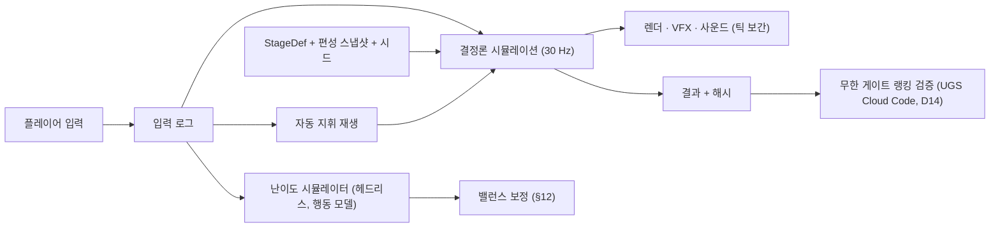

# 02. 게임 기획서 (GDD) — ARMY OF ONE (가칭)

> 장르: 3D 탑다운 타워 디펜스(명일방주 방식) + 주인공 성장 RPG · 플랫폼: 모바일 Landscape · 엔진: Unity 6 URP · 아트: Synty SIMPLE
> 상태: **초안 v0.1 (상세 설계 1차)** · 작성일: 2026-11-03 · 선행: [00 컨셉 제안서](00_컨셉_제안서.md), [01 벤치마킹](01_벤치마킹_명일방주.md) · 후속: [03 흐름 · 구조 다이어그램](03_게임_흐름_구조_다이어그램.md), [04 시나리오 · 챕터](04_시나리오_챕터_스테이지.md), 05 에셋 매핑(보류), [06 HUD · UX](06_HUD_UX_설계.md), [07 난이도 시뮬레이션 계획](07_난이도_시뮬레이션_계획.md), [08 시뮬레이션 결과](08_난이도_시뮬레이션_결과.md), [09 데이터 · 밸런스 시트](09_데이터_밸런스_시트.md), [10 기술 설계(TDD)](10_기술_설계_문서_TDD.md), [11 BM](11_비즈니스_모델_BM.md)
> 이 문서는 전투 · 성장 규칙을 **구현 가능한 수치**로 정한다. 모든 수치는 초기값이며, 난이도 시뮬레이션(이전 프로젝트 `tools/difficulty_sim` 재활용)으로 보정한다. 보정 대상 수치는 표에 **[시뮬]** 로 표시했다.

---

## 0. 전제 결정 (D1~D14)

사용자 확정 전이므로 00 · 01 문서의 **권장안을 채택**했다. 바꾸면 영향받는 절을 함께 적었다. 결정이 바뀌면 해당 절만 고친다.

| # | 결정 | 채택안 | 바꾸면 영향 |
| :-: | :--- | :--- | :--- |
| D1 | 주인공 조작 | 재배치(탭-탭), 쿨 8s | §5.3, §11 |
| D2 | DP 경제 | 자연 회복 0.7/s + 주인공 처치 획득 | §4 전체 |
| D3 | 군단원 획득 · BM | 참전 시나리오 전용, 스킨 · 패스 | §6.6, §10.2 |
| D4 | 이성(스태미너) | 없음. 자원 게이트만 일일 상한 | §10.3 |
| D5 | 스탯 배분 | 5스탯 + 무료 리셋 | §5.8 |
| D6 | 주인공 HP 0 | 넉다운 10s, ★3 불가 | §5.6, §8.4 |
| D7 | 편성 규모 | 주인공 + 8 | §6.7, §11 |
| D8 | 전장 · 카메라 | 13×8, 피치 55° / 요 20° | §3.1, §3.2 |
| D9 | 런칭 챕터 | 5 / 10 | §5.9, §7.5 |
| D10 | IP 거리두기 | 고유 명칭 전면 사용 | 전체 |
| D11 | 기반시설 | 런칭 제외, "협회 의뢰" 1화면 | §10.4 |
| D12 | 배치 제한에 주인공 포함 | 미포함 | §6.7 |
| D13 | 특화 · 모듈 | 런칭 후 시즌 2 | §6.5 |
| D14 | 서버 검증 | 무한 게이트 랭킹만 UGS Cloud Code | §9.4 |

---

## 1. 게임 개요

### 1.1 컨셉
- "한 명은 압도적으로 강하다. 하지만 한 곳에만 설 수 있다."
- 플레이어는 **주인공**(낙인을 받은 헌터)을 전장에서 직접 옮겨 가며 싸우고, 주인공이 거둔 **군단원**을 명일방주 방식으로 타일에 **소집**해 게이트를 막는다.
- 명일방주의 전투 문법(타일 · DP · 저지 · 방향 · 스킬 · ★3)을 그대로 쓰고, 바꾸는 것은 **주인공 한 축**뿐이다.

### 1.2 설계 기둥 (00 문서 §2.2 요약)
| 기둥 | 이 문서에서의 구현 |
| :--- | :--- |
| P1 한 명의 강함, 한 곳의 제약 | 주인공 제약 4종(§5.7) + 레벨 디자인 규칙 R1(§8.3) |
| P2 명일방주 문법 유지 | §3 · §4 · §6의 규칙은 01 문서 §3과 동일. 차이는 표에 "변경" 표시 |
| P3 성장이 보인다 | 레벨 · 스탯 · 스킬 트리(§5.8~5.10), 군단원 성장(§6.5), 참전 시나리오(§10.2) |
| P4 가챠 없는 수집 | §6.6, §10.2 |
| P5 단순한 그림, 선명한 정보 | 적 변형 규칙(§7.3), 타일 · HUD(§3.1, §11) |

---

## 2. 코어 루프

```
[로비] 편성(주인공 + 군단원 8) · 주인공 성장 · 군단원 성장
   → [게이트 선택] 맵 정보(경로 · 적 목록 · 배치 제한) 확인
   → [전투] 주인공 배치 → 웨이브: 소집 · 재배치 · 스킬 · 권능 → 클리어(★2/★3) 또는 실패
   → [결과] XP · 골드 · 재료 · (조건 충족 시) 참전 시나리오 해금
   → [로비] 레벨업 · 스탯 배분 · 스킬 트리 · 군단원 레벨 · 각성 · 새 군단원 합류
```

| 루프 | 길이 | 내용 |
| :--- | :--- | :--- |
| 스테이지 | 2~4분 (보스 4~6분) | 초반 DP 운영 → 중반 다중 경로 대응 → 후반 엘리트 · 보스 |
| 세션 | 10~15분 | 스테이지 2~4개 + 로비 성장 1~2건 |
| 일일 | 15~30분 | 일일 수련 3개 + 자원 게이트 + 무한 게이트 1회 |
| 챕터 | 3~5일 | 메인 8스테이지 + 참전 시나리오 1~2 + 보스 → 헌터 등급 승급 |

---

## 3. 전장

### 3.1 타일 (D8)
- 그리드 **13×8** 기본. 범위 11×7 ~ 15×9. 1타일 = 1 Unity 유닛(1m). 좌표 (x, y), 원점 좌하단.
- 고지대 높이 0.5 유닛. 배치 불가 구조물 높이 1.0 이상(실루엣 구분).

| 타일 | 코드 | 소집 | 적 통행 | 비고 |
| :--- | :-: | :--- | :--- | :--- |
| 지상 | G | 지상 군단원 · 주인공 | 가능 | 저지가 일어나는 곳 |
| 고지대 | H | 고지대 군단원 | 불가 | 주인공 불가 |
| 배치 불가 | X | 불가 | 불가 | 건물 · 물 · 균열. 사거리 계산에는 포함 |
| 통로 | P | 불가 | 가능 | 배치 불가인 길(다리 · 협곡). 주인공도 불가 |
| 출현 지점 | S | 불가 | 시작점 | 붉은 균열 VFX. 복수 가능 |
| 방어 지점 | D | 불가 | 종점 | 파란 결계 VFX. 도달 시 생명 −1. 복수 가능 |
| 봉인 | L | 군단원 가능, **주인공 불가** | 가능 | 보스 구역 등. 보라색 문양 |
| 함정 | T | 지상과 동일 | 가능 | 적 통과 시 고정 대미지 300 × 챕터 배율, 1회성 |
| 가속 | A | 지상과 동일 | 가능 | 적 이속 +50% (통과 중) |
| 치유 | R | 지상과 동일 | 가능 | 위에 선 아군 HP +2%/s |

- 특수 타일(T · A · R)은 4장부터 등장. 이벤트마다 신규 타일을 1종씩 추가한다(명일방주의 기믹 실험 방식).

### 3.2 카메라 (D8)
| 항목 | 값 |
| :--- | :--- |
| 투영 | 원근, FOV 30° (직교에 가까운 타일 정렬) |
| 피치 / 요 | 55° / 20° (고지대 측면이 보이도록) |
| 프레이밍 | 스테이지별 고정. 13×8 전장이 16:9에서 좌우 여백 1타일, 상하 0.5타일. 21:9는 좌우 여백 확대 |
| 줌 · 회전 | 없음 |
| 배치 모드 | 드래그 시작 시 시간 배속 0.2× + 격자 데칼 강조 + 사거리 미리보기 |

### 3.3 경로와 출현
- 적은 출현 지점 → 경로(웨이포인트 열) → 방어 지점. 경로는 스테이지 데이터에 명시(§8.2). 동적 경로 탐색 없음(결정론 · 가독성).
- 경로 길이 12~30타일. 적 기본 속도 1.0타일/s → 통과 12~30초.
- 웨이브: 스폰 엔트리 {t, enemy, route, count, interval}. 적 총수 20~60. 화면 상단 "적 12/40"으로 진행 표시.
- 비행 적은 비행 전용 경로(지상 타일 · 배치 불가 타일 위를 직선으로)를 쓴다. 4장부터.

### 3.4 생명 · 승패
| 항목 | 값 |
| :--- | :--- |
| 생명 | 기본 5 (튜토리얼 1-1 · 1-2: 10, 보스: 3). 범위 3~10 |
| 생명 감소 | 적 1체 도달 = −1. 보스 도달 = 전부(즉시 실패) |
| 클리어 | 적 총수 소진(처치 + 통과) 시점에 생명 ≥ 1 |
| 실패 | 생명 0. 보상 없음. 이성이 없으므로 환급 개념 없음 |
| 평가 | §8.4 |

---

## 4. DP 경제 (D2)

### 4.1 규칙
| 규칙 | 값 | 명일방주 대비 |
| :--- | :--- | :--- |
| 초기 DP | 스테이지 지정, 기본 10 | 동일 |
| 자연 회복 | **0.7 DP/s** (내부 0.1 단위 누적, 표시는 내림) [시뮬] | 1.0/s의 70% |
| 주인공 처치 획득 | 일반 **+1**, 엘리트 **+2**, 보스 **+5**. 주인공의 공격이 처치했을 때만 | 변경(선봉 대체) |
| 군단원 처치 | 0 | 변경 |
| 상한 | 99 | 동일 |
| 하한 | 0 (음수 없음) | 변경 |
| 소집 | 코스트만큼 차감 | 동일 |
| 귀환 환급 | 현재 코스트의 50% 내림 | 동일 |
| 재소집 코스트 | 1회 ×1.5, 2회째부터 ×2 (내림, 상한 99) | 동일 |
| 이탈(HP 0) | 환급 없음, 재소집 대기 ×2 | 변경(대기 2배) |

### 4.2 예산 예시 (150초 일반 스테이지, 적 30)
| 항목 | DP |
| :--- | :-: |
| 초기 | 10 |
| 자연 회복 150s × 0.7 | 105 |
| 주인공 처치 (일반 20 + 엘리트 3) | 26 |
| **합계** | **141** |
| 지출: 군단원 8명 초기 소집(평균 코스트 14) | 112 |
| 여유: 재소집 2회 또는 고코스트 2명 교체 | 29 |

- 설계 의도: 주인공이 적을 많이 잡는 위치에 서면 **약 20%** 의 추가 경제가 생긴다. 주인공을 "뚫리는 곳"으로 옮기면 그 20%를 포기한다. 이 둘 사이의 선택이 매 스테이지 반복된다.
- 지휘 스탯(§5.8)과 군주 트리(§5.10)가 이 비율을 키운다. 상한은 자연 회복의 50%.

### 4.3 코스트 범위
| 클래스 | 기본 코스트 (★4) | ★5 | ★6 |
| :--- | :-: | :-: | :-: |
| 방패 | 16 | 18 | 20 |
| 창병 | 14 | 16 | 18 |
| 사수 | 12 | 13 | 15 |
| 술사 | 18 | 20 | 22 |
| 치유 | 15 | 16 | 18 |
| 지원 | 14 | 15 | 17 |
| 특수 | 10 | 11 | 12 |
| 주인공 | 0 | — | — |

- ★3은 ★4 −2. 잠재(§6.5)로 최대 −2.

---

## 5. 주인공

### 5.1 기본 능력치
| 상태 | HP | ATK | DEF | RES | 저지 | 공격 간격 | 비고 |
| :--- | :-: | :-: | :-: | :-: | :-: | :-: | :--- |
| 각성 전 (1-1 · 1-2) | 1,000 | 180 | 80 | 0 | 1 | 1.0s | 재배치 · 기세 · 권능 없음. 일반 지상 유닛과 동일 규칙(코스트 0, 귀환 가능) |
| 각성 후 Lv.1 | **3,300** | **800** | **150** | 10 | 3 | 0.9s | 이하 전부 적용 |
| Lv.60 (스탯 미배분) | 10,100 | 2,450 | 460 | 10 | 3 | 0.9s | 레벨 성장만 |

- 레벨 성장: `stat(L) = base × (1 + 0.035 × (L − 1))`. Lv.60 → ×3.065. [시뮬]
- 같은 성장 단계의 ★4 창병(§6.2) 대비 ATK 2.1배, HP 3.0배. 범위 공격(§5.4)이라 실효 화력은 그 이상.

### 5.2 등장 · 배치
- 스테이지 시작 직후 **배치 단계**: 시간이 흐르지 않고(첫 적 출현 전 3초 카운트) 플레이어가 지상(G) 타일 하나를 고른다. 고르지 않으면 3초 후 스테이지 지정 기본 타일에 자동 배치.
- 코스트 0, 배치 제한 수에 포함하지 않음(D12). 귀환 불가.
- 방향: 가장 가까운 적을 자동으로 향한다. 적이 없으면 가장 가까운 출현 지점.

### 5.3 재배치 (D1, 핵심 조작)
| 항목 | 값 |
| :--- | :--- |
| 입력 | 하단 주인공 카드 탭 (또는 전장의 주인공 탭) → 이동 가능 타일 하이라이트 → 타일 탭. 취소: 빈 곳 탭 |
| 이동 가능 | 모든 지상(G · T · A · R) 타일 중 군단원이 없는 곳. 봉인(L) · 고지대(H) · 통로(P) 불가. **거리 제한 없음** |
| 연출 | 0.4s "낙인 이동"(출발 타일 검은 원 → 도착 타일 솟아오름). 이동 중 저지 해제, 피격 없음, 공격 없음 |
| 쿨타임 | **8.0s** 기본. 민첩 스탯으로 최소 5.0s. 쿨 중 카드에 링 표시 |
| 제약 | 넉다운 중 불가. 권능 시전 중(0.5s) 불가 |
| 배속 | 2× 중에도 쿨은 게임 시간 기준(실시간 4s) |

- 설계 근거: 거리 제한을 두지 않는 대신 쿨을 둔다. "어디로 가느냐"가 아니라 "지금 가느냐, 8초 뒤에 가느냐"가 선택이 되도록 한다. 거리 제한은 프로토타입 검증 후 추가 여부 결정(§13).

### 5.4 공격
| 항목 | 값 |
| :--- | :--- |
| 유형 | 물리 |
| 범위 | 자기 타일 + 바라보는 방향 전방 1타일 (무쌍 트리 ①로 전방 2타일) |
| 대상 | 범위 내 **모든 적** (최대 5체). 저지 중인 적은 항상 포함 |
| 간격 | 0.9s (민첩으로 최소 0.63s) |
| 표적 우선 | 저지 중 → 방어 지점에 가까운 순 |

### 5.5 기세 (Momentum)
| 항목 | 값 |
| :--- | :--- |
| 획득 | 주인공이 적을 처치할 때마다 +1 스택 |
| 상한 | 10 (무쌍 ③로 15) |
| 효과 | 스택당 ATK +3%, 공격 간격 −3% (10스택: +30% / −30%) |
| 감소 | 5초간 처치 없으면 1스택씩 감소 (5초마다) |
| 초기화 | 넉다운 시 0 |

### 5.6 권능 (Ultimate) — SP 시스템
| 항목 | 값 |
| :--- | :--- |
| SP 충전 | **전장의 아군(주인공 + 군단원) 누구든** 적 1체 처치 시 +1. 엘리트 +2, 보스 페이즈 전환 +5. 시간 충전 없음 |
| 발동 | 수동. 우측 권능 버튼 탭 → (방향형이면) 스와이프 → 0.5s 시전 |
| 장착 | 스킬 트리 각 갈래 끝 노드 1개. 로비에서 교체 |

| 권능 | 갈래 | 필요 SP | 효과 |
| :--- | :--- | :-: | :--- |
| 일섬 | 무쌍 | 20 | 스와이프 방향 직선 5타일. 범위 내 모든 적에게 ATK 300% 물리 + 1.0s 기절. 비행 적 포함 |
| 총소집 | 군주 | 25 | 재소집 대기 중인 군단원 전원 즉시 소집 가능 + 코스트 배율 ×1로 초기화. 전장의 군단원 ATK +30% 10s |
| 지배 | 불굴 | 30 | 주인공 2타일 내 비보스 적 1체(최고 HP)를 10s 아군화(그 자리에서 적을 저지 · 공격). 종료 시 소멸, DP +2 |

- 1-6에서 일섬 해금. 총소집 · 지배는 트리에서 획득.

### 5.7 넉다운과 제약 (D6)
| 항목 | 값 |
| :--- | :--- |
| 넉다운 | HP 0 → "무릎 꿇음" **10s** (불굴 ②로 6s). 저지 · 공격 · 재배치 · 권능 불가. 피격 없음. 적은 그대로 통과 |
| 기립 | HP **30%** (불굴 ⑤로 50%). 기세 0. 재배치 쿨 초기화(즉시 이동 가능) |
| 평가 | 넉다운 1회 이상 → ★3 불가 |
| 패배 | 주인공 넉다운으로는 패배하지 않는다. 패배는 생명 0뿐 |

주인공 제약 4종 (P1):
1. **한 타일에만** — 동시에 두 경로를 막을 수 없다.
2. **지상 타일만** — 고지대 사격 · 치유는 군단원이 한다.
3. **비행 적 저지 불가** — 비행 적은 사수 · 술사가 잡는다. (일섬만 예외)
4. **넉다운** — 압도되면 10초간 길이 열린다.

추가: 주인공 공격은 물리뿐이다. 마법 저항이 낮고 DEF가 높은 적(§7.2 E04 · E06)에게는 술사가 필요하다.

### 5.8 스탯 배분 (D5)
- 레벨당 스탯 포인트 **3** (Lv.2부터). Lv.60 → 177. 스탯당 상한 80. 로비에서 무료 리셋(횟수 무제한).

| 스탯 | 1포인트 효과 | 상한(80pt) 효과 |
| :--- | :--- | :--- |
| 힘 | ATK +1.5% (base 기준) | +120% |
| 체력 | HP +2.0% | +160% |
| 방어 | DEF +2.0%, RES +0.25 | +160%, RES +20 |
| 민첩 | 공격 간격 −0.4% (최대 −30%), 재배치 쿨 −0.05s (최대 −3s) | 간격 0.63s, 쿨 5s (각각 75pt · 60pt에서 상한) |
| 지휘 | 처치 DP +2% (0.1 단위 누적), 군단원 HP · ATK +0.25% (최대 +25%) | 처치 DP ×2.6, 군단원 +20% |

- 빌드 예시: "무쌍형" 힘 80 · 민첩 60 · 체력 37 / "군주형" 지휘 80 · 체력 60 · 방어 37 / "불굴형" 체력 80 · 방어 80 · 힘 17.

### 5.9 레벨 · XP · 등급 (D9)
| 항목 | 값 |
| :--- | :--- |
| 레벨 상한 | 1장 15 · 2장 25 · 3장 35 · 4장 45 · 5장 60 (런칭). 6~10장 70~110 (시즌 2) |
| 다음 레벨 XP | `60 × L^1.4` (Lv.1→2: 60, Lv.14→15: 2,420, Lv.59→60: 18,100). Lv.15 누적 ≈ 14,000, Lv.60 누적 ≈ 445,000 [시뮬] |
| 스테이지 XP | 첫 클리어 `300 × 챕터 배율(§7.5) × 스테이지 계수(1.0~2.0)`, ★3 보너스 +20%, 반복 40%. 1장: 300~700 |
| 자원 게이트(XP) | 1회 400 × 챕터 배율, 일 3회 |
| 헌터 등급 | E(시작) → D(1장 보스) → C(2장) → B(3장) → A(5장) → S(9장). 수치 효과 없음. 외형(코트 · 무기) · NPC 대사 · 로비 타이틀 변경 |

### 5.10 스킬 트리
- 스킬 포인트: Lv.5 · 10 · … · 60에서 1씩(12) + 챕터 보스 첫 클리어 1씩(5) = 런칭 **17**. 노드 ①~⑤ 비용 1, ⑥(권능) 비용 2. 갈래 하나 완성 = 7. 순서 고정(①→⑥). 무료 리셋.

| 갈래 | ① | ② | ③ | ④ | ⑤ | ⑥ 권능 |
| :--- | :--- | :--- | :--- | :--- | :--- | :--- |
| 무쌍 | 공격 범위 전방 2타일 | 처치 시 HP 5% 회복 | 기세 상한 15 | 3회 공격마다 추가 타격 ATK 50% | 치명타 15%, ×1.8 | 일섬 |
| 군주 | 일반 적 처치 DP +1 (합계 +2) | 군단원 소집 코스트 −1 | 재소집 시간 −20% | 주인공 인접 8타일 군단원 ATK +15% | 자연 회복 +0.2/s | 총소집 |
| 불굴 | HP +20% | 넉다운 6s | 저지 4 | 피격 시 DEF +10% (5스택, 10s) | 저지 5, 기립 HP 50% | 지배 |

### 5.11 장비 (요약)
- 슬롯 3: 무기(ATK · 공격 간격) · 방어구(HP · DEF) · 장신구(특수: 처치 DP, 기세 지속, 재배치 쿨). 게이트 드랍 · 제작. 등급 4단계. 런칭 영향 범위: 스탯 합계의 ±15% 이내로 제한(가챠가 없으므로 격차 억제). 상세는 09 문서.

---

## 6. 군단원

### 6.1 공통 규칙 (명일방주와 동일)
| 항목 | 규칙 |
| :--- | :--- |
| 소집 | 하단 바에서 카드 드래그 → 타일 드롭 → 스와이프로 4방향. DP ≥ 현재 코스트, 배치 제한 내, 지형 일치 |
| 등장 | 타일 위 검은 낙인 원 → 0.5s 솟아오름. 등장 중 피격 없음, 저지 없음 |
| 방향 | 소집 시 고정. 사거리 템플릿은 방향 기준 |
| 저지 | 지상 유닛만. 저지 중인 적은 이동 정지. 저지 수 초과 적은 통과 |
| 귀환 | 유닛 탭 → 귀환. 50% 환급, 재소집 대기 시작 |
| 이탈 | HP 0. 환급 없음, 재소집 대기 ×2, 코스트 배율 상승 |
| 재소집 대기 | 클래스별 70s (특수 18s). 군주 ③로 −20% |
| 표적 | 기본: 사거리 내 방어 지점에 가장 가까운 적. 지상 유닛은 저지 중인 적 우선. 사수는 비행 우선 |
| 치유 대상 | 사거리 내 HP 비율 최저 아군. 주인공 포함 |

### 6.2 클래스 템플릿 (★4 · 각성 0 · Lv.1 기준) [시뮬]
| 클래스 | 위치 | HP | ATK | DEF | RES | 저지 | 코스트 | 재소집 | 간격 | 사거리 | 대미지 |
| :--- | :-: | :-: | :-: | :-: | :-: | :-: | :-: | :-: | :-: | :-: | :--- |
| 방패 | G | 1,500 | 220 | 280 | 10 | 3 | 16 | 70s | 1.2s | R1 | 물리, 단일 |
| 창병 | G | 1,100 | 380 | 150 | 0 | 2 | 14 | 70s | 1.0s | R1 | 물리, 단일 |
| 사수 | H | 700 | 300 | 90 | 0 | 1 | 12 | 70s | 1.0s | R3 | 물리, 단일, 비행 우선 |
| 술사 | H | 650 | 360 | 60 | 10 | 1 | 18 | 70s | 1.6s | R3 | 마법, 단일 |
| 치유 | H | 700 | 220 | 80 | 0 | 1 | 15 | 70s | 2.0s | R3 | 치유량 = ATK |
| 지원 | H | 750 | 200 | 80 | 15 | 1 | 14 | 70s | 1.4s | R4 | 마법, 단일 + 감속 20% 1s |
| 특수 | G/H | 800 | 300 | 100 | 0 | 1 | 10 | **18s** | 0.9s | R1 | 물리, 단일 |

- 레벨 성장: `stat(L) = base × (1 + 0.03 × (L − 1))`. 각성 1: base ×1.2 + 사거리 확장. 각성 2: base ×1.4 + 3번째 스킬(★6) 또는 재능 강화.
- 희귀도 배율(§6.6)을 곱한다. ★6 각성 2 Lv.70: 1.0 × 3.07 × 1.4 × 1.25 ≈ base의 5.4배.
- 주인공 Lv.60(스탯 배분 포함 약 ×1.9) ≈ base의 5.8배. 즉 **최종 성장에서 주인공과 ★6 군단원의 단일 능력치는 비슷**하고, 주인공의 우위는 범위 공격 · 코스트 0 · 넉다운(불사) · 재배치에서 나온다.

### 6.3 사거리 템플릿 (■ = 자기 타일, X = 사거리, 오른쪽이 전방)
```
R1 (근접)          R3 (원거리 기본)      R3+ (각성 1 확장)     R4 (지원)
■ X                . X X .               . X X X               X X X .
                   ■ X X X               ■ X X X X             X ■ X X
                   . X X .               . X X X               X X X .
```
- 고지대 유닛은 지상 · 고지대 · 배치 불가 타일 위의 적을 모두 쏠 수 있다(높이 무시).
- 비행 적은 R1 유닛의 표적이 되지 않는다(저지도 불가). 사수 · 술사 · 지원 · 치유(공격 시)만 표적 가능.

### 6.4 스킬 · SP
| 항목 | 규칙 |
| :--- | :--- |
| 충전 유형 | 자연(1 SP/s) · 공격(공격 1회당 1) · 피격(피격 1회당 1) |
| 발동 | 수동(SP 충전 후 카드 또는 유닛 탭) · 자동(충전 즉시) · 패시브 |
| 초기 SP | 스킬별 0~50% |
| 스킬 수 | ★3 1개 / ★4 · ★5 2개(2번째 각성 1 해금) / ★6 3개(3번째 각성 2 해금) |
| 랭크 | 1→7. 랭크당 주 수치 +5% (랭크 7 = +30%), 랭크 4 · 7에서 필요 SP −1 |

VS용 클래스 대표 스킬 (각 1개):
| 클래스 | 스킬 | 충전 | 발동 | 필요 SP | 효과 |
| :--- | :--- | :--- | :--- | :-: | :--- |
| 방패 | 철벽 | 자연 | 수동 | 30 | 10s DEF +100%, 저지 +1 |
| 창병 | 강타 | 공격 | 자동 | 5 | 다음 공격 ATK 250% |
| 사수 | 속사 | 자연 | 수동 | 25 | 10s 공격 간격 −50% |
| 술사 | 폭렬 | 자연 | 수동 | 30 | 대상 중심 3×3 범위 ATK 200% 마법 |
| 치유 | 응급 | 자연 | 수동 | 20 | 사거리 내 아군 전원 HP 25% 즉시 회복 |
| 지원 | 둔화 | 자연 | 수동 | 25 | 8s 사거리 내 적 이속 −40% |
| 특수 | 급습 | — | 패시브 | — | 소집 직후 5s ATK +50%, 재소집 18s |

### 6.5 성장 (D13: 특화 · 모듈은 시즌 2)
| 단계 | 재화 | 효과 |
| :--- | :--- | :--- |
| 레벨 | 기록 결정(XP 아이템) + 골드 | 능력치. 상한: 각성 0 → 30, 각성 1 → 50, 각성 2 → 60(★4) / 65(★5) / 70(★6). ★3은 각성 1 45까지 |
| 각성 1 | 재료 T1~T2 + 골드 | base ×1.2, 사거리 R3 → R3+, 2번째 스킬, 외형(낙인 문양 발광) |
| 각성 2 | 재료 T3~T4 + 골드, ★4 이상 | base ×1.4, 3번째 스킬(★6) 또는 재능 강화, 외형(장비 교체) |
| 스킬 랭크 1→7 | 스킬 서(書) + 재료 | §6.4 |
| 잠재 1→6 | 유대 과제 · 참전 시나리오 재클리어(도전 조건) | 코스트 −1(잠재 2 · 5), 재소집 −5s(3), HP +5%(4), ATK +5%(6) |
| 유대 0→100 | 출격 · 일일 수련 동행 | 50: HP · ATK +3%, 100: +6% + 로비 대사 · 프로필 해금 |

### 6.6 희귀도 (D3)
| 희귀도 | 능력치 배율 | 코스트 | 스킬 | 획득 난이도 |
| :-: | :-: | :-: | :-: | :--- |
| ★3 | 0.85 | ★4 −2 | 1 | 메인 합류 |
| ★4 | 1.00 | 기본 | 2 | 메인 · 숨은 합류 |
| ★5 | 1.12 | +1~2 | 2 | 숨은 합류(조건) · 이벤트 |
| ★6 | 1.25 | +3~4 | 3 | 챕터 보스 후 · 고난도 참전 시나리오 |

- 희귀도 = "얻기 어려운 시나리오"의 표현이다. 확률은 없다.

### 6.7 편성 · 배치 제한 (D7, D12)
| 항목 | 값 |
| :--- | :--- |
| 편성 | 주인공(고정) + 군단원 **8** |
| 편성 프리셋 | 4개 |
| 배치 제한(동시 전장) | 스테이지별 **4~8**, 기본 6. 주인공 미포함 |
| 지원 군단원 | 없음(오프라인 · 친구 시스템 미도입). 메인 스테이지 일부에 "협회 파견" NPC 유닛이 미리 배치됨(튜토리얼 · 서사용) |
| 협회 파견대 | **1장 한정** 임시 편성: 파견 창병 · 파견 사수(★3 고정 Lv.10, 성장 불가). 2장 시작 시 소멸 (04 문서 §4.1) |

---

## 7. 적

### 7.1 속성 · 대미지 공식 (명일방주와 동일)
| 항목 | 규칙 |
| :--- | :--- |
| 속성 | HP · ATK · DEF · RES(0~100) · 속도(타일/s) · 중량(0~5) · 비행 · 능력 |
| 물리 | `max(ATK − DEF, ATK × 0.05)` |
| 마법 | `max(ATK × (1 − RES / 100), ATK × 0.05)` |
| 고정 | 그대로 |
| 밀치기 · 당기기 | 특수 군단원 힘 ≥ 중량일 때만. 구멍 타일 없음(런칭). 1타일 이동 |
| 공격 | 근접(저지한 아군) / 원거리(사거리 내 아군, 주인공 포함) / 범위 |
| 비행 | 저지 불가, 비행 경로, R1 표적 불가 |

### 7.2 베이스 적 10종 (1장 기준값) [시뮬]
| ID | 이름 | HP | ATK | DEF | RES | 속도 | 중량 | 비행 | 능력 | 첫 등장 |
| :-: | :--- | :-: | :-: | :-: | :-: | :-: | :-: | :-: | :--- | :-: |
| E01 | 고블린 | 1,350 | 156 | 20 | 0 | 1.0 | 1 | — | — | 1-1 |
| E02 | 고블린 궁수 | 1,050 | 182 | 10 | 0 | 0.9 | 1 | — | 원거리 2타일 | 1-3 |
| E03 | 고블린 돌격병 | 2,100 | 234 | 60 | 0 | 1.4 | 2 | — | 저지된 첫 공격 ×2 | 1-5 |
| E04 | 스켈레톤 병사 | 2,400 | 260 | 120 | 20 | 0.8 | 2 | — | — (고DEF) | 2-1 |
| E05 | 스켈레톤 주술사 | 1,500 | 286 | 30 | 40 | 0.8 | 1 | — | 마법 원거리 3타일 | 2-3 |
| E06 | 거대 오크 | 6,750 | 456 | 200 | 10 | 0.6 | 4 | — | 밀치기 면역 | 2-6 |
| E07 | 박쥐 떼 | 750 | 116 | 0 | 0 | 1.1 | 0 | ✓ | 비행 (변종 박쥐 군단: HP 800 · 속도 1.0, 지상 경로를 날아옴) | 4-1 |
| E08 | 좀비 | 3,300 | 208 | 40 | 60 | 0.5 | 2 | — | 1회 부활(HP 50%) | 7-1 (이벤트 조기 등장 가능) |
| E09 | 배신 헌터 | 4,200 | 416 | 150 | 30 | 1.0 | 2 | — | 은신(저지 전 원거리 표적 불가) | 3-2 |
| E10 | 정찰 드론 | 1,350 | 196 | 80 | 0 | 1.2 | 0 | ✓ | 비행 · 원거리 2타일 | 6-1 |
| E11 | 길드 용병 | 2,000 | 300 | 100 | 10 | 1.0 | 2 | — | — (인간 적) | 3-1 |
| E12 | 엘프 사수 | 1,500 | 320 | 60 | 20 | 0.9 | 1 | — | 원거리 3타일 | 4-3 |
| E13 | 엘프 암살자 | 2,200 | 420 | 80 | 20 | 1.3 | 1 | — | 은신 | 4-5 |
| E14 | 오크 전사 | 3,600 | 380 | 150 | 10 | 0.8 | 3 | — | — | 4-1 |
| E15 | 사원 석상 | 5,000 | 300 | 350 | 0 | 0.5 | 4 | — | 밀치기 면역 (고DEF · RES 0 → 술사) | 5-1 |
| E16 | 사원 기사 | 4,000 | 450 | 200 | 30 | 0.9 | 2 | — | — (인간형 엘리트) | 5-5 |
| E17 | 제단 소환물 | 1,200 | 200 | 20 | 0 | 1.2 | 1 | — | 맵 중앙 제단에서 출현 | 5-3 |

> **1차 보정(08 문서)**: 위 표는 시뮬레이션 1차 보정값이다(초기값 대비 HP ×1.5, ATK ×1.3). 초기값에서는 기준 정책이 1장 전 스테이지 ★3 100%, 주인공 단독으로도 보스까지 클리어해 기둥 P1이 성립하지 않았다.
> **원거리 적 공격 간격**: 근접 1.0s, 원거리 1.5s, 마법 원거리 2.5s (2~5장 보정: 1초 간격 마법이 방패를 5초 만에 녹였다). 비행 속도는 1.1~1.2 (사수 커버리지 3칸 안에 2초 이상 머물도록).

- 주인공 Lv.1(ATK 800)은 E01을 2타격, E04를 4타격, E06을 12타격에 잡는다. E05(RES 40)는 술사(360 × 0.6 = 216)보다 주인공 물리(800 − 30)가 여전히 강하다 — 술사의 존재 이유는 E04 · E06 · 보스(DEF 200+, RES 낮음)다.
- 적 ATK vs 주인공 DEF 150: E01 = 8(5% 최소) · E03 = 84 · E09 = 266. 1장에서 주인공은 거의 다치지 않고(시뮬: 1-2 각성 전 넉다운 6%뿐), 3장부터 넉다운 위험이 생기도록 설계한다.

### 7.3 변형 규칙 (P5)
| 변형 | 능력치 | 식별 | DP · SP |
| :--- | :--- | :--- | :--- |
| 일반 | ×1.0 | 기본 색 | +1 / +1 |
| 엘리트 | HP ×2.0, ATK ×1.4, DEF ×1.3 | 스케일 1.15 + 붉은 머리 장식 + 머리 위 "!" 아이콘 | +2 / +2 |
| 변종(무기) | 능력 1개 추가(원거리 · 방패 · 가속) | 무기 교체 + 아이콘 | +1 / +1 |
| 보스 | 개별 | 스케일 1.5~2.0 + 체력 바 상단 고정 | +5 / 페이즈당 +5 |

- 베이스 10종 × 변형 3종 = 런칭 적 25종 + 보스 5종 목표. 색 변경은 **챕터 테마 색**(1장 녹색 계열 → 2장 회색 → 3장 검정 · 적색 …)으로 통일해 챕터 구분을 돕는다.

### 7.4 기믹 도입 순서
| 챕터 | 신규 기믹 | 대응 수단 |
| :-: | :--- | :--- |
| 1 | 원거리 적, 돌진 | 방패로 받기, 주인공 범위 공격 |
| 2 | 고DEF, 마법 원거리, 중량 4 | 술사, 치유, 밀치기 포기 |
| 3 | 은신(배신 헌터), 다중 출현 지점 | 지상 저지 후 사격, 재배치 |
| 4 | 비행, 함정 · 가속 타일 | 사수, 타일 활용 |
| 5 | 보스 페이즈 · 봉인 타일, 소환(보스가 적 생성) | 군단 단독 방어 구간 |
| 6~10 | 기계(RES 0 · DEF 高), 부활, 경로 변경, 아군 디버프, 공중 보스 | 시즌 2 |

### 7.5 챕터 배율 [시뮬]
| 챕터 | HP | ATK | DEF · RES | 주인공 레벨 상한 | 비고 |
| :-: | :-: | :-: | :-: | :-: | :--- |
| 1 | 1.00 | 1.00 | 1.00 | 15 | 기준 |
| 2 | 1.15 | 1.12 | 1.09 | 25 | |
| 3 | 1.33 | 1.27 | 1.18 | 35 | 넉다운 위험 시작 |
| 4 | 1.54 | 1.45 | 1.27 | 45 | 비행 |
| 5 | 1.84 | 1.66 | 1.39 | 60 | 런칭 최종 |
| 6~10 | 2.2 → 4.6 | 2.0 → 3.7 | 1.6 → 2.3 | 70 → 110 | 시즌 2 (같은 비율로 축소) |

> **2차 보정(08 §8)**: 초기 표(2장 1.25/1.20/1.15 … 5장 2.40/2.10/1.65)의 초과분을 ×0.6으로 줄였다. 기본 보정(HP ×1.5 · ATK ×1.3) 위에 초기 배율을 곱하면 4~5장이 기준 정책에서도 클리어 0~5%였다. 보스 수치는 배율을 적용하지 않는 최종값이다. 챕터별 초기 DP는 12 / 15 / 18 / 20(+3 보스, +3 3경로 이상), 자연 회복 0.7 / 0.75 / 0.8 / 0.85.

- 목표: 챕터 n의 마지막 일반 스테이지를 **주인공 레벨 상한 −5, 군단원 각성 0 Lv.30**에서 ★2, 상한 · 각성 1에서 ★3. 보스는 상한 · 각성 1 · 스킬 랭크 4에서 ★3. 시뮬레이션으로 보정.

### 7.6 보스 공통 규칙
| 항목 | 규칙 |
| :--- | :--- |
| 페이즈 | 2~3. 페이즈 전환 시 2s 무적 + 연출, 봉인 타일 변화 가능 |
| 저지 | 저지 가능(중량 5 → 밀치기 불가). 저지 중에도 범위 공격으로 저지 유닛 외 아군 타격 |
| 방어 지점 도달 | 즉시 실패 |
| 체크포인트 | 없음(명일방주와 동일). 보스 스테이지 생명 3 |
| 런칭 보스 5종 | 1장 하수도 군주(HP 40,000 · ATK 300 · 속도 0.28, 광폭화 ×2, 소환 경로) · 2장 백골 기사단장(48,000 · 350 · DEF 300, 돌진, 2페이즈 DEF ×1.5, 광폭화) · 3장 배신 길드장(55,000 · 380, 은신, 분신 소환, 광폭화) · 4장 붉은 게이트 수호수(80,000 · 450, 비행 → 착지(33~66%) → 비행, **비행 중 제자리 선회**) · 5장 사원의 군단주(100,000 · 450 · RES 50, 마법 원거리 3, 봉인 5 → 7 → 9칸 확장, 소환). 상세는 04 문서 §7. 보스 ATK는 350~450을 넘기지 않는다(주인공 DEF는 거의 성장하지 않으므로 ATK 450 초과 시 주인공이 먼저 넉다운) |
| 보스 설계 원칙(시뮬 교훈) | 보스전을 "주인공 DPS vs 보스 ATK"의 경주로 만들지 않는다. 보스는 HP 높고 ATK 중간 · 느린 **지연전**, 소환물은 주인공이 못 가는 경로로 보내 군단 필요성을 만든다. 저지되지 않은 보스는 **광폭화(속도 ×2)** 해 주인공이 보스를 떠나 소환물을 쫓는 솔로 플레이를 막는다 |

---

## 8. 스테이지

### 8.1 유형
| 유형 | 수 (런칭) | 생명 | 배치 제한 | 보상 | 비고 |
| :--- | :-: | :-: | :-: | :--- | :--- |
| 메인 게이트 | 5챕터 × 8 = 40 | 5 (보스 3) | 4~8 | XP · 골드 · 재료, 첫 ★3: 젬 · 스킬 포인트(보스) | 스토리 |
| 참전 시나리오 | 10 (챕터당 2) | 5 | 6 | 군단원 합류 | 1~3 스테이지 연작 |
| 자원 게이트 | 4종 (XP · 골드 · 재료 T1~2 · 재료 T3~4) | 5 | 6 | 해당 재화 | 요일 로테이션, 일 3회 (D4) |
| 무한 게이트 | 1 (주간 갱신) | 10 | 8 | 웨이브 수 기준 골드 · 명성 | 주간 랭킹(D14) |
| 도전 모드 | 메인 40 전부 | 메인과 동일 | 메인 −1~2 | 첫 클리어 젬 | §8.5 |
| 위협 계약 · 심연 | — | — | — | — | 시즌 2 |

### 8.2 스테이지 정의 (StageDef) — 스키마 예시
```json
{
  "id": "1-4",
  "chapter": 1,
  "type": "main",
  "name": "하수도 교차로",
  "grid": { "w": 13, "h": 8, "tiles": "XXGGGGGGGGGXX/..." },
  "lives": 5,
  "initial_dp": 10,
  "dp_regen": 0.7,
  "deploy_limit": 6,
  "hero_default_tile": [6, 3],
  "sealed_tiles": [],
  "routes": {
    "A": [[0, 6], [4, 6], [4, 3], [12, 3]],
    "B": [[0, 1], [8, 1], [8, 3], [12, 3]]
  },
  "waves": [
    { "t": 3,  "enemy": "E01", "route": "A", "count": 4, "interval": 2.0 },
    { "t": 15, "enemy": "E01", "route": "B", "count": 3, "interval": 2.5 },
    { "t": 30, "enemy": "E02", "route": "A", "count": 2, "interval": 3.0 },
    { "t": 45, "enemy": "E01_elite", "route": "B", "count": 1, "interval": 0 }
  ],
  "enemy_total": 10,
  "scale": { "hp": 1.0, "atk": 1.0, "def": 1.0 },
  "npc_units": [],
  "rewards": { "xp": 450, "gold": 300, "drops": [["T1_core", 0.5]] },
  "first_clear": { "gem": 10 },
  "unlock_scenario": { "id": "SC-01", "condition": "hero_kill:E01_elite" },
  "challenge": { "mods": ["deploy_limit-2", "enemy_hp+30"] },
  "seed": 104
}
```
- 타일 문자열은 §3.1 코드. 경로는 타일 중심 좌표의 웨이포인트. 비행 경로는 `"routes_air"`.
- `unlock_scenario`는 숨은 합류 조건(§10.2). `seed`는 결정론 난수 시드(§9).
- 전체 40 + 10 + 4 스테이지의 StageDef는 04 문서(와 후속 스테이지 상세 문서)에서 정의하고 `unity/Data/Stages/*.json`으로 내보낸다(이전 프로젝트 파이프라인 재사용).

### 8.3 레벨 디자인 규칙
| # | 규칙 | 이유 |
| :-: | :--- | :--- |
| R1 | **1-4 이후 모든 메인 스테이지는 경로 2개 이상**, 그중 1쌍은 "주인공 한 명이 재배치 쿨 8s 안에 둘 다 막을 수 없는" 간격. **경로가 공유하는 타일은 통로(P) 또는 봉인(L)** 으로 두어 한 자리에서 두 경로를 막지 못하게 하고, **두 경로의 웨이브는 같은 시각에 겹치게** 배정한다(시뮬: 겹치지 않으면 주인공이 임박 누수 시점마다 왕복해 솔로 ★3) | P1 "주인공 없는 길" (08 문서 F3 · F4) |
| R2 | 고지대 타일 ≥ 소집 가능 타일의 15% (1-4부터, 튜토리얼 1-1~1-3 예외) | 군단 역할 보장 |
| R3 | 비행 적은 4장부터. 비행 경로는 반드시 고지대 사거리(R3) 2곳 이상이 닿도록. 첫 비행 웨이브는 20초 이후(사수를 소집할 DP가 생긴 뒤) | 사수 · 술사 역할 |
| R4 | 챕터당 "주인공만으로 ★3 가능한 스테이지" ≤ 20% (시뮬레이션으로 측정) | 00 문서 리스크 |
| R5 | 고DEF(E04 · E06) 또는 보스는 챕터당 3스테이지 이상 | 술사 역할 |
| R6 | 보스 스테이지는 봉인 타일로 보스 구역을 막고, 보스 구역에서 나오는 경로 1개 이상 | 군단 단독 방어 구간 |
| R7 | 스테이지 길이 120~240s, 적 20~60, 동시 전장 적 ≤ 20 (성능 예산) | 세션 · 성능 |
| R8 | 첫 적 출현까지 3s. 경로가 3개 이상이면 개막 웨이브를 12초 간격으로, 2개면 8초 간격으로 벌린다(초기 DP로 저지 2명을 살 시간) | 초반 템포 |
| R9 | 챕터당 신규 기믹 ≤ 2, 기믹 소개 스테이지는 그 기믹만 단독 등장 | 온보딩 |

### 8.4 평가 (D6)
| 평가 | 조건 | 보상 |
| :-: | :--- | :--- |
| ★3 | 생명 손실 0 **그리고** 주인공 넉다운 0 | 첫 ★3: 젬 + 자동 지휘 해금 |
| ★2 | 클리어했으나 생명 손실 또는 넉다운 있음 | 첫 클리어 보상, 드롭률 −20% |
| 실패 | 생명 0 | 없음 |

- 명일방주의 ★3 / ★2에 넉다운 조건만 더했다. ★1은 없다(이성이 없으므로 "아쉬운 클리어"에 보상을 깎을 이유가 적다).

### 8.5 난이도 모드
| 모드 | 조건 | 평가 |
| :--- | :--- | :--- |
| 일반 | 기본 | ★2 / ★3 |
| 도전 | 스테이지별 변형 2개 조합: 배치 제한 −2 / DP 회복 −30% / 적 HP +30% / 재배치 쿨 +4s / 특정 클래스 소집 불가 | 클리어 시 "도전" 마크(명일방주 ★4) |
| 연습 | 보상 · 해금 · 기록 없음, 횟수 무제한 | 없음 |

### 8.6 배속 · 일시정지 · 자동 지휘
| 항목 | 규칙 |
| :--- | :--- |
| 배속 | 1× / 2×. 시뮬레이션 틱은 동일, 프레임당 처리 틱 수만 2배 |
| 일시정지 | 시뮬레이션 정지. 정지 중 소집 · 귀환 · 스킬 · 재배치 · 권능 입력 가능(명일방주와 동일) |
| 자동 지휘 | ★3 클리어의 입력 로그를 저장 → 같은 편성 · 같은 레벨 이상으로 재생. 편성 · 성장이 바뀌면 "결과가 다를 수 있음" 경고. 재생 중 실패하면 수동 전환 |
| 앱 백그라운드 | 자동 일시정지, 복귀 시 3-2-1 카운트 |

---

## 9. 결정론 전투 시뮬레이션

명일방주의 "자동 지휘 = 입력 로그 재생"(01 문서 §11.1)을 그대로 쓴다. 전투는 **입력 로그만으로 완전히 재현**되어야 한다.

### 9.1 규칙
| 항목 | 결정 |
| :--- | :--- |
| 틱 | 고정 **30 Hz** (dt = 1/30 s). 렌더 프레임과 분리 |
| 위치 | 정수 고정소수점(1/1000 타일). 부동소수점 누적 금지 |
| HP · 대미지 · DP · SP | 정수(DP · SP는 0.1 단위 정수). 백분율 계산은 정수 나눗셈 순서 고정 |
| 난수 | xorshift32, 시드 = StageDef.seed. 사용처: 치명타(무쌍 ⑤), 드랍(전투 외). 그 외 난수 금지 |
| 처리 순서 | 매 틱: 입력 적용 → 스폰 → 이동 → 저지 판정 → 공격(유닛 ID 순) → 스킬 · 버프 만료 → 사망 처리 → DP · SP 가산 → 승패 판정 |
| 플랫폼 | 결과가 iOS · Android · 에디터에서 동일해야 함. 유닛 테스트: 리플레이 100개의 해시 비교 |

### 9.2 입력 로그
```json
{ "stage": "1-4", "seed": 104, "version": "0.1.0",
  "squad": ["HERO", "L_SHIELD_01", "L_SPEAR_01", "..."],
  "inputs": [
    { "tick": 0,   "cmd": "HERO_PLACE", "x": 6, "y": 3 },
    { "tick": 210, "cmd": "DEPLOY", "unit": "L_SPEAR_01", "x": 4, "y": 5, "dir": "E" },
    { "tick": 900, "cmd": "SKILL", "unit": "L_SPEAR_01" },
    { "tick": 1320, "cmd": "HERO_MOVE", "x": 8, "y": 2 },
    { "tick": 2100, "cmd": "ULT", "dir": "N" },
    { "tick": 2400, "cmd": "RETREAT", "unit": "L_SPEAR_01" }
  ],
  "result": { "cleared": true, "lives": 5, "knockdowns": 0, "stars": 3, "hash": "9f2c…" } }
```
- 배속 · 일시정지는 로그에 남기지 않는다(시뮬레이션에 영향 없음).
- `hash`는 최종 상태(생명 · 처치 수 · 각 유닛 HP)의 해시. 리플레이 검증 · 서버 검증(D14)에 쓴다.

### 9.3 파이프라인


### 9.4 서버 검증 (D14)
- 오프라인 플레이가 기본이므로 메인 · 참전 · 자원 게이트는 검증하지 않는다.
- 무한 게이트 랭킹 제출 시에만 입력 로그 + 해시를 UGS Cloud Code로 보내 헤드리스 시뮬레이션으로 재검증한다. 시뮬레이션 코어는 Unity 의존성 없는 순수 C# 어셈블리로 분리한다(10 TDD).

---

## 10. 메타 (요약 — 상세는 06 · 09 · BM 문서)

### 10.1 로비 화면
| 화면 | 내용 |
| :--- | :--- |
| 게이트 지도 | 챕터 · 스테이지 선택, 맵 정보(경로 · 적 목록 · 배치 제한 · 권장 레벨), 참전 · 자원 · 무한 게이트 입구 |
| 군단 | 편성 프리셋 4, 군단원 목록 · 성장(레벨 · 각성 · 스킬 · 잠재 · 유대), 참전 시나리오 진행도 |
| 주인공 | 레벨 · 스탯 배분 · 스킬 트리 · 장비 · 등급 |
| 수련 | 일일 수련 3 · 주간 과제 · 자원 게이트 · 협회 의뢰(D11) |
| 기록 | 회상(지난 이벤트 참전 시나리오 재도전), 아카이브 |
| 상점 | 스킨 · 패스 · 편의(BM 문서) |

### 10.2 참전 시나리오 (D3)
| 종류 | 해금 | 런칭 수 |
| :--- | :--- | :-: |
| 메인 합류 | 챕터 진행 중 자동(스토리 스테이지 클리어) | 10 (챕터당 2) |
| 숨은 합류 | 메인 스테이지의 `unlock_scenario` 조건: 특정 적을 주인공이 직접 처치 / 민간인 NPC 생존 / 특정 타일에 군단원 소집 / 넉다운 0 ★3 등 | 10 |
| 이벤트 합류 | 기간 한정, 종료 후 "회상"에서 재도전 가능 | 4 (시즌 1) |

- 참전 시나리오는 1~3 스테이지 연작 + 짧은 컷씬(3D 디오라마). 마지막 스테이지는 그 군단원이 **NPC로 미리 배치되어 함께 싸운다** → 클리어 후 낙인 연출 → 합류.
- 재클리어(도전 조건)로 잠재가 오른다(§6.5). 명일방주 "중복 → 잠재"의 대체.

### 10.3 일일 · 주간 (D4)
| 항목 | 내용 |
| :--- | :--- |
| 일일 수련 | 3개: 처치 50 · 스테이지 3회 · 재배치 10회 (예). 보상 XP · 골드 · 재료 |
| 자원 게이트 | 요일 로테이션 4종, 각 일 3회. 스테이지 자체는 메인과 동일 규칙 |
| 무한 게이트 | 주간 맵 1개, 웨이브 무한(5웨이브마다 배율 +15%), 생명 10. 최고 웨이브 랭킹 |
| 주간 과제 | 누적 처치 · 참전 시나리오 · 무한 게이트 웨이브 |

### 10.4 협회 의뢰 (D11, 기반시설 대체)
- 1화면. 군단원 1~3명을 의뢰에 파견(4h · 8h · 12h) → 골드 · 재료 · 유대. 파견 중 편성 불가. 전투 외 가치는 이것만으로 제한한다.

### 10.5 재화
| 재화 | 획득 | 용도 |
| :--- | :--- | :--- |
| 골드 | 스테이지 · 자원 게이트 · 의뢰 | 모든 성장 비용 |
| 기록 결정 | 자원 게이트(XP) · 스테이지 | 군단원 레벨 |
| 재료 T1~T4 | 스테이지 드랍 · 자원 게이트 · 제작 | 각성 · 스킬 · 장비 |
| 스킬 서 | 자원 게이트 · 주간 과제 | 스킬 랭크 |
| 명성 | 무한 게이트 · 주간 과제 | 명성 상점(재료 · 스킨 조각) |
| 젬 | 첫 ★3 · 도전 · 과금 | 스킨 · 편의. 성장 재화 직접 구매 불가 |

---

## 11. 조작 · HUD · 온보딩

### 11.1 조작 요약
| 조작 | 입력 |
| :--- | :--- |
| 소집 | 카드 드래그 → 드롭 → 스와이프 방향 |
| 귀환 · 스킬 | 전장 유닛 탭 → 버튼 2개 |
| 재배치 | 주인공 카드(또는 유닛) 탭 → 타일 탭 |
| 권능 | 우측 버튼 탭 (방향형은 스와이프) |
| 배속 · 일시정지 | 좌상단 |

### 11.2 HUD (00 문서 §6.1 레이아웃 유지)
- 상단: 일시정지 · 배속 / 생명 · 적 카운터 / 설정. 우측: DP(큰 숫자) + 배치 제한 "3/6" + 권능 버튼(SP 링). 하단: 주인공 카드(쿨 링 · 기세 스택 · HP) + 군단원 카드 8(코스트 · 재소집 타이머 · SP 바).
- 드래그 중: 격자 강조, 사거리 미리보기, 시간 0.2×.
- 주인공 머리 위: 기세 스택 아이콘(5 · 10에서 색 변화), 넉다운 카운트다운.

### 11.3 온보딩 — 1장 해금 순서 (R9)
| 스테이지 | 해금 | 서사 |
| :-: | :--- | :--- |
| 1-1 | 소집(드래그 · 방향), 저지, 생명. 주인공은 각성 전 약한 유닛, NPC 헌터 2명 미리 배치 | C급 게이트 레이드 짐꾼 |
| 1-2 | 귀환 · 재소집, 스킬(자동 발동 1종) | 게이트가 오판이었다. 레이드 붕괴 |
| 1-3 | **각성**: 주인공 능력치 변경, 재배치, 기세. 솔로(방어 지점 2) | 낙인. 시스템 창 첫 등장. 클리어 후 SC-01(도경 합류) |
| 1-4 | 수동 스킬, 경로 2개(R1 첫 적용) | 생존자 구조 |
| 1-5 | 고지대 · 사수, 분기 경로 · 통로 타일, 돌진 적 | 고참 방패 헌터 합류(SC-02) |
| 1-6 | 권능 일섬, 엘리트 적 | 하수도 깊은 곳 |
| 1-7 | 교차 경로, 고블린 정찰병 합류(SC-03), 결과 창에서 숨은 합류 조건 공개, 도전 모드 소개 | 예속의 첫 경험 |
| 1-8 | 보스(페이즈 · 봉인 타일) | 하수도 군주. D급 승급 |

---

## 12. 밸런스 초기값 요약 · 검증 계획

### 12.1 핵심 수치 한눈에
| 항목 | 값 |
| :--- | :--- |
| 전장 | 13×8, 지상 / 고지대 / 봉인 외 7종 |
| DP | 초기 10, 회복 0.7/s, 처치 +1/+2/+5, 상한 99, 환급 50%, 재소집 ×1.5 → ×2 |
| 주인공 Lv.1 | HP 3,300 · ATK 800 · DEF 150 · 저지 3 · 간격 0.9s · 범위 전방 1타일 |
| 재배치 | 쿨 8s(최소 5s), 연출 0.4s, 거리 무제한 |
| 기세 | 최대 10스택, +3%/스택, 5s 미처치 시 감소 |
| 권능 | SP 처치당 +1, 일섬 20 · 총소집 25 · 지배 30 |
| 넉다운 | 10s, 기립 30%, ★3 불가 |
| 군단원 | 7클래스, 편성 8, 배치 제한 4~8, 재소집 70s(특수 18s) |
| 적 | 베이스 10 × 변형 3 + 보스 5, 챕터 배율 HP 1.0 → 2.4 |
| 평가 | ★3 무손실 + 넉다운 0 / ★2 / 실패 |
| 성장 | 주인공 Lv.60 · 스탯 177pt · 스킬 17pt, 군단원 각성 2 Lv.70 |

### 12.2 검증 계획
| 단계 | 방법 | 판정 기준 |
| :--- | :--- | :--- |
| 1. 헤드리스 시뮬레이터 | **완료(07 · 08 문서)**: 등가 모델 + 행동 정책 6종 × 성장 3단계, 1장 8스테이지 × 1,000런(목표 곡선 전부 충족) · 2~5장 32스테이지 × 300런(3차 보정, D ★3 < 50% 2개 남음) · 참전 시나리오 28 | 각 스테이지 ★3 확률 곡선이 07 §6 목표에 맞는가 |
| 2. 주인공 단독 테스트 | **완료**: 정책 S(솔로) | 챕터당 솔로 ★3 가능 스테이지 ≤ 20% (R4) — 1~5장 충족(NPC 동행 스테이지 제외) |
| 3. DP 민감도 | **완료**: 회복 0.5~1.0/s, 처치 DP 0~2 (08 §5) | "주인공 위치 선택"이 ★3 확률을 10%p 이상 바꾸는 스테이지 비율 ≥ 50% |
| 4. 재배치 쿨 | **완료**: 5 · 8 · 12s (08 §5) | 쿨 8s에서 재배치 횟수가 스테이지당 1~6회 |
| 5. 그레이박스 플레이테스트 | 1장 8스테이지, 명일방주 경험자 5 · 비경험자 5 | 1-3 이탈률, "주인공이 강하다"와 "군단이 필요하다" 동시 체감 |

---

## 13. 미결 사항 · 다음 문서

| # | 미결 | 결정 시점 |
| :-: | :--- | :--- |
| U1 | 재배치 거리 제한(무제한 vs 5타일) | 그레이박스 프로토타입 후 |
| U2 | 권능 SP를 군단원 처치에도 주는 것이 군단 의존도를 충분히 만드는가 | 시뮬레이션 2단계 |
| U3 | 1-1 · 1-2 각성 전 주인공의 귀환 허용 여부(튜토리얼 혼란 vs 서사) | 04 시나리오 |
| U4 | 지원 군단원(NPC 파견) 범위 | 04 시나리오 |
| U5 | ~~장비 시스템의 런칭 포함 여부(§5.11)~~ → 런칭 포함, 판매 · 가챠 없음 | [11 BM](11_비즈니스_모델_BM.md) B7 |
| U6 | 구멍 타일(밀치기 즉사) 도입 | 시즌 2 |

다음 문서:
1. ~~04 시나리오 · 챕터 · 스테이지~~ — 작성 완료: [04](04_시나리오_챕터_스테이지.md).
2. **05 에셋 매핑** — 보유 Synty 인덱스(prefab_index.json) 재검색, 군단원 24 · 적 10 베이스 · 보스 5 · 챕터 환경 5 매핑, 자체 제작 목록.
3. ~~06 HUD · UX~~ — 완료: [06](06_HUD_UX_설계.md).
4. ~~07 · 08 난이도 시뮬레이션~~ — 완료: [07 계획](07_난이도_시뮬레이션_계획.md) · [08 결과](08_난이도_시뮬레이션_결과.md).
5. ~~09 데이터 · 밸런스 시트~~ — 완료: [09](09_데이터_밸런스_시트.md) (`docs/data/*.csv`, `params.yaml` · StageDef에서 생성).
6. ~~10 TDD~~ — 완료: [10](10_기술_설계_문서_TDD.md). 결정론 코어 스캐폴딩 `core/Army.Core`(컴파일 미검증).
7. ~~11 BM~~ — 완료: [11](11_비즈니스_모델_BM.md).
8. **05 에셋 매핑** · **Unity 그레이박스** — Unity 사용 가능 시.
