# 03. 게임 흐름 · 구조 다이어그램 — ARMY OF ONE (가칭)

> 목적: [02 GDD](02_게임기획서_GDD.md)의 규칙을 **한눈에 보이는 그림**으로 정리한다. 각 다이어그램은 GDD의 해당 절을 참조하며, 규칙이 바뀌면 GDD를 먼저 고치고 이 문서를 따라 고친다.
> 작성일: 2026-11-03 · 형식: Mermaid (GitHub에서 바로 렌더링) · 14종

| # | 다이어그램 | 묻는 질문 | GDD 참조 |
| :-: | :--- | :--- | :--- |
| 1 | 게임 구조 맵 | 게임이 어떤 덩어리로 이루어지는가 | §1, §10 |
| 2 | 플레이어 여정 | 플레이어가 무엇을 반복하는가 | §2 |
| 3 | 일일 루프 | 하루에 무엇을 하는가 | §2, §10.3 |
| 4 | 스테이지 흐름 | 전투 한 판이 어떻게 흘러가는가 | §3, §4, §8 |
| 5 | 주인공 상태 머신 | 주인공은 어떤 상태를 오가는가 | §5 |
| 6 | 군단원 상태 머신 | 군단원은 어떤 상태를 오가는가 | §6.1 |
| 7 | 인게임 자원 흐름 | DP · SP · 기세가 어디서 와서 어디로 가는가 | §4, §5.5, §5.6 |
| 8 | 메타 경제 순환 | 로비의 재화가 어떻게 도는가 | §10.5 |
| 9 | 군단원 획득 흐름 | 가챠 없이 어떻게 모으는가 | §10.2 |
| 10 | 성장 구조 | 주인공과 군단원은 무엇으로 자라는가 | §5.8~5.11, §6.5 |
| 11 | 콘텐츠 · 챕터 구조 | 막 · 챕터 · 스테이지가 어떻게 포개지는가 | §8.1, 01 §9.3 |
| 12 | 전투 시퀀스 | 입력이 어떻게 로그 · 시뮬레이션 · 화면으로 가는가 | §9 |
| 13 | 시스템 아키텍처 | 클라이언트 · UGS · 도구가 어떻게 연결되는가 | §9.4, 10 TDD |
| 14 | 데이터 모델 | 어떤 데이터가 무엇을 가리키는가 | §8.2 |

---

## 1. 게임 구조 맵

게임은 로비 · 콘텐츠 · 전투 · 성장 네 덩어리로 나뉜다(실선 = 구성, 점선 = 순환). 로비에서 게이트를 고르면 모든 게이트는 하나의 결정론 전투로 들어가고, 전투의 보상이 성장으로, 성장이 다시 편성 · 빌드로 돌아온다. 참전 시나리오만이 군단원을 늘리는 유일한 입구다.

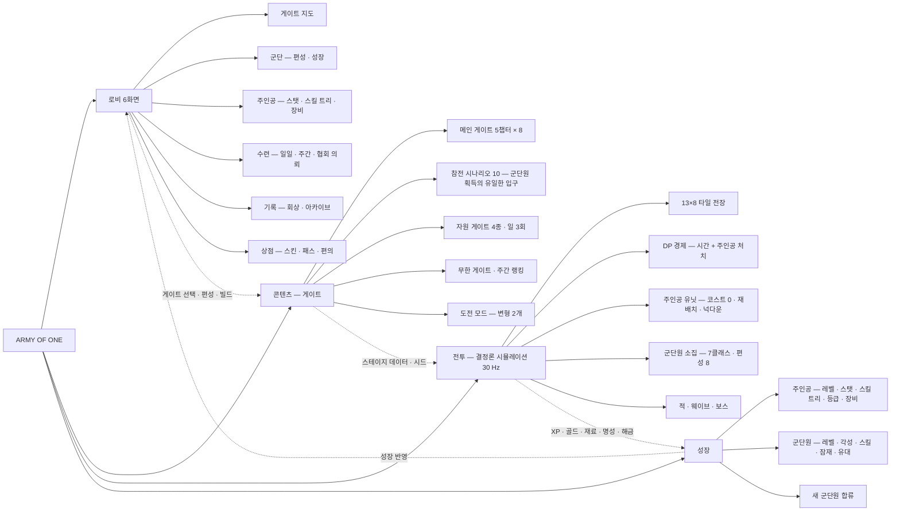

---

## 2. 플레이어 여정

첫 실행은 1-1~1-3의 서사형 튜토리얼이 곧 각성 서사다. 이후에는 "게이트 선택 → 전투 → 보상 → 성장 → 다음 게이트"를 반복하고, 챕터 보스마다 등급이 오른다. 실패에 비용이 없으므로(이성 없음) 실패 → 편성 수정 → 재도전이 짧다.

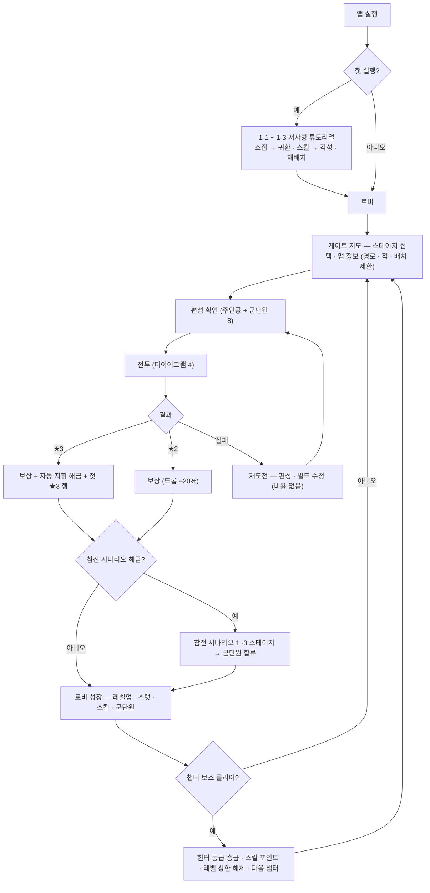

---

## 3. 일일 루프

이성이 없으므로 "하루의 할 일"은 횟수 상한이 있는 자원 게이트와 과제로 정의된다. 15~30분.

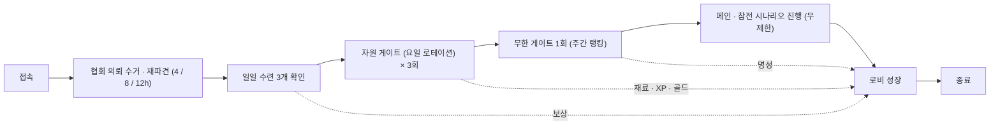

---

## 4. 스테이지 흐름

명일방주의 스테이지 흐름에 **배치 단계(주인공)**, **주인공 처치 DP**, **넉다운** 세 가지가 더해졌다. 평가는 무손실 + 넉다운 0일 때만 ★3.

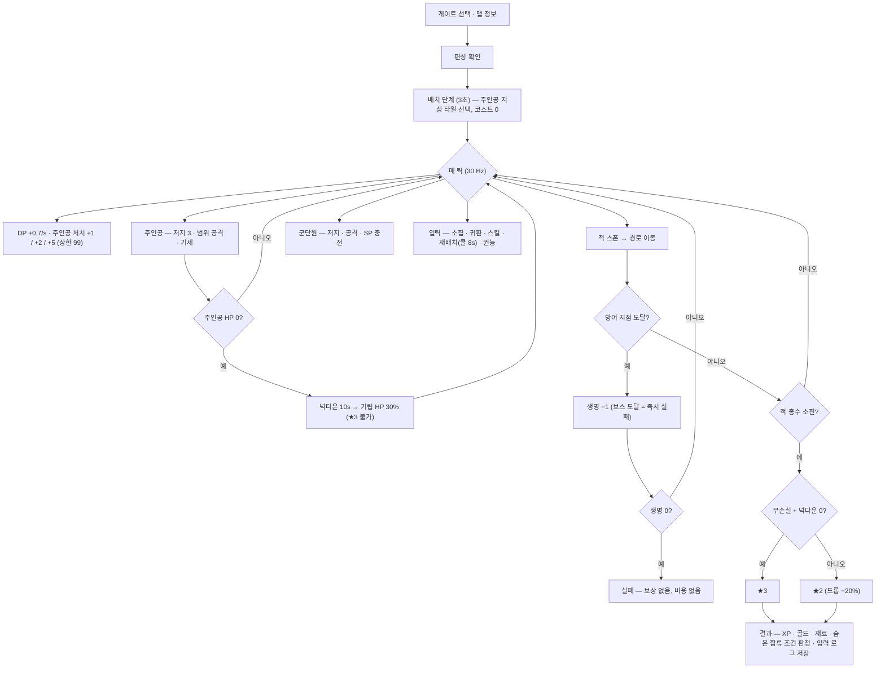

---

## 5. 주인공 상태 머신

귀환이 없고 죽지 않는다. 대신 재배치(이동 중 무적 · 저지 해제)와 넉다운(10초 공백)이 있다. 기세는 전투 상태에서만 쌓이고 넉다운에서 0이 된다.

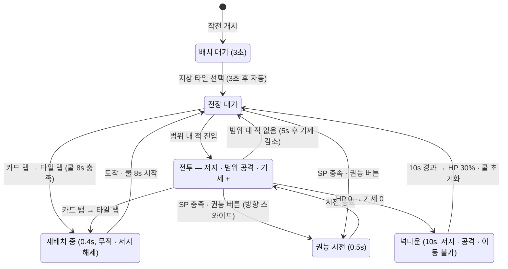

---

## 6. 군단원 상태 머신

명일방주 오퍼레이터와 같은 규칙이다. 용어만 소집 · 귀환 · 이탈 · 재소집으로 바뀌고, 이탈 시 재소집 대기가 2배가 된다.

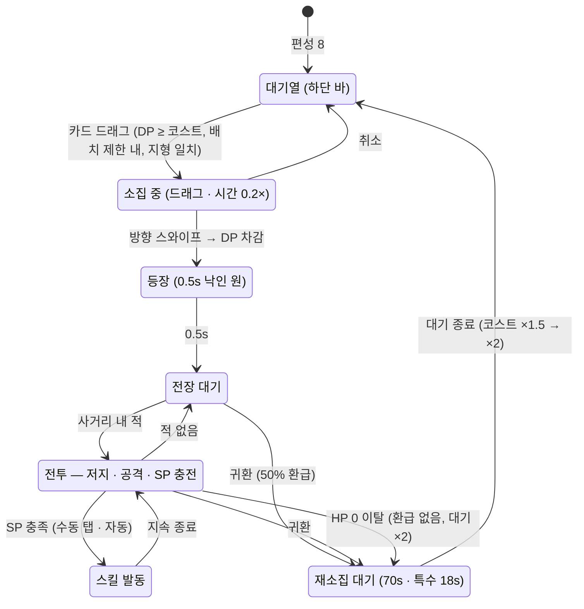

---

## 7. 인게임 자원 흐름 (DP · SP · 기세)

DP는 시간과 **주인공의 처치**에서만 나온다. SP는 **누구의 처치든** 권능을 채운다(군단 의존). 기세는 주인공 자신의 처치로만 쌓인다.

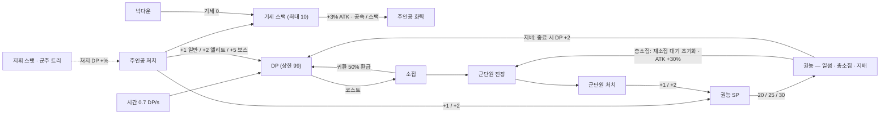

---

## 8. 메타 경제 순환

젬은 스킨 · 패스 · 편의에만 쓰고 성장 재화를 직접 사지 못한다. 성장은 전부 플레이 재화로 돈다.

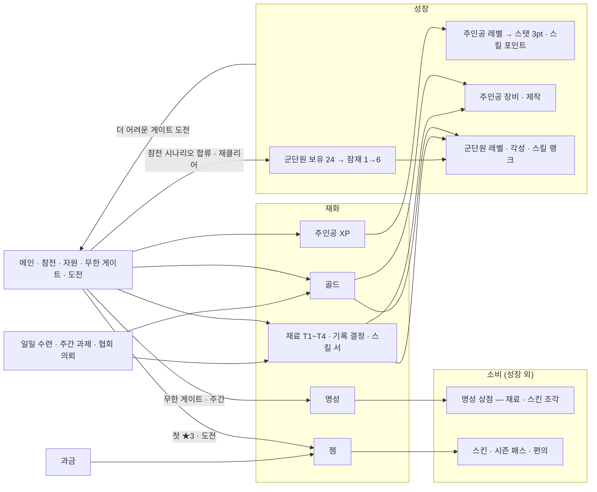

---

## 9. 군단원 획득 흐름

세 입구(메인 · 숨은 · 이벤트)가 모두 같은 참전 시나리오 구조로 들어간다. 마지막 스테이지에서는 그 군단원이 NPC로 함께 싸운 뒤 합류한다.

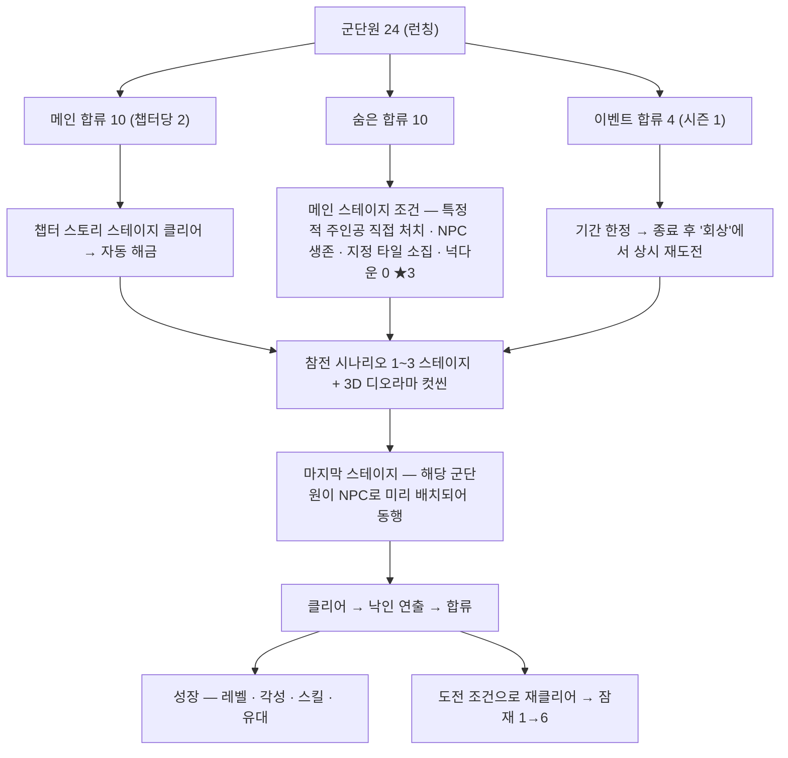

---

## 10. 성장 구조

주인공은 **플레이 XP**로, 군단원은 **아이템(기록 결정 · 재료)** 으로 자란다. 챕터 보스가 두 축을 잇는다(등급 · 스킬 포인트 · 레벨 상한).

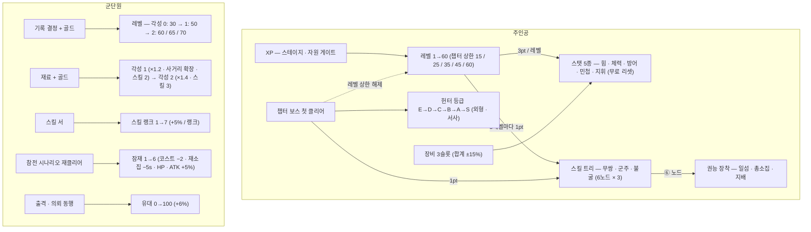

---

## 11. 콘텐츠 · 챕터 구조

2막 10챕터. 런칭은 1막 5챕터. 챕터 하나는 메인 8(보스 포함) + 참전 2 + 숨은 1~2 + 도전이다. 라이브는 3주 이벤트 템플릿으로 돈다.

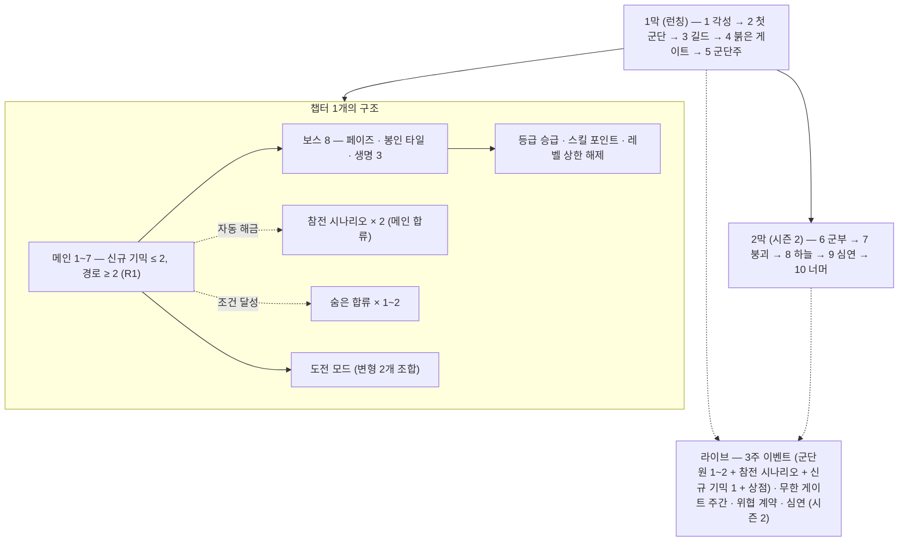

---

## 12. 전투 시퀀스

모든 입력은 먼저 **입력 로그**에 기록되고, 시뮬레이션은 로그만 읽는다. 그래서 자동 지휘 · 리플레이 · 랭킹 검증이 한 구조에서 나온다.

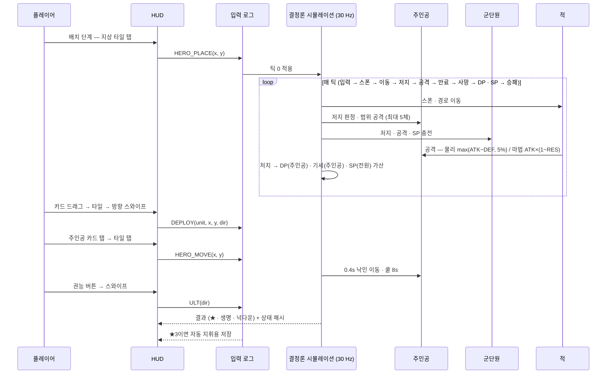

---

## 13. 시스템 아키텍처

Unity 6 · URP, 오프라인 플레이 가능, 자체 서버 없음(UGS만 사용, 이전 프로젝트 결론 재사용). 전투 코어는 Unity 의존성 없는 순수 C# 어셈블리로 분리해 헤드리스 시뮬레이터 · Cloud Code 검증 · 리플레이 테스트가 같은 코드를 쓴다.

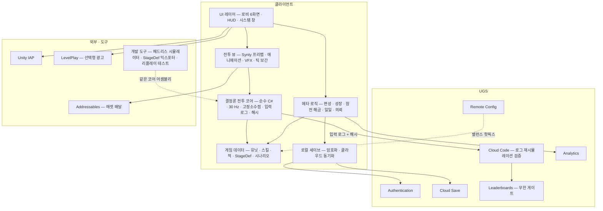

---

## 14. 데이터 모델

군단원 정의(UNIT_DEF)는 반드시 하나의 참전 시나리오(SCENARIO_DEF)에 묶인다. 가챠 테이블이 없는 대신 시나리오가 획득 경로다. 전투 기록(BATTLE_RECORD)은 입력 로그와 해시로 리플레이 · 검증에 쓴다.

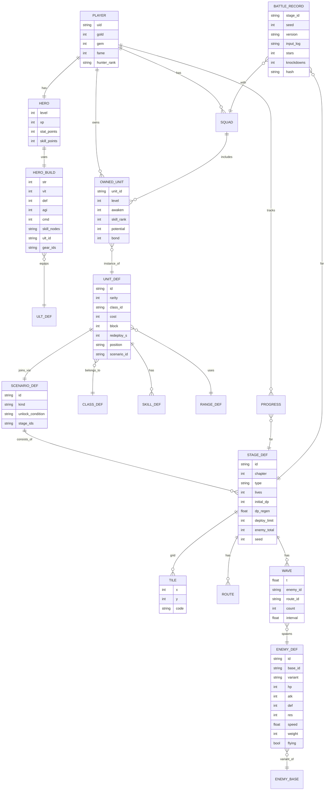

---

## 사용 안내
- 다이어그램은 GitHub 마크다운에서 바로 렌더링된다. 로컬 확인은 `tools/mermaid_check/`(validate.js · render_all.js, Mermaid 11.4 고정)를 쓴다. 이 문서의 14종은 전부 검증 · 렌더링 확인을 마쳤다.
- 수치는 전부 GDD의 초기값이다. GDD에서 [시뮬] 표시된 값이 보정되면 7 · 8 · 10번 다이어그램의 라벨을 함께 갱신한다.
