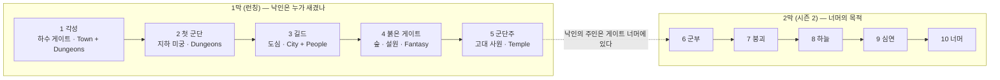
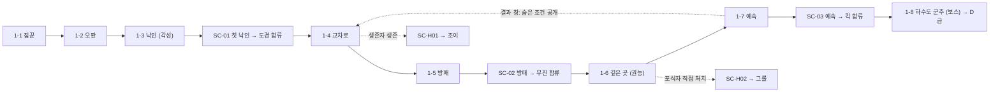

# 04. 시나리오 · 챕터 · 스테이지 — ARMY OF ONE (가칭)

> 목적: 1막(1~5장) 메인 40스테이지, 참전 시나리오 10(18스테이지), 숨은 합류 10, 이벤트 합류 4, 보스 5를 정의하고 **1장 8스테이지의 StageDef를 데이터로 제공**한다. 2막(6~10장)은 골격만 둔다.
> 상태: 초안 v0.1 · 작성일: 2026-11-03 · 선행: [00](00_컨셉_제안서.md) · [01 §9](01_벤치마킹_명일방주.md) · [02 GDD](02_게임기획서_GDD.md) · [03 다이어그램](03_게임_흐름_구조_다이어그램.md)
> 데이터: `unity/Data/Stages/Stage_{1..5}-*.json`(40), `unity/Data/Enemies.json`, `unity/Data/StageIndex.json` — 원본은 `tools/gen_ch1_stagedefs.py` · `tools/gen_ch2_5_stagedefs.py`, 인덱스 `tools/build_stage_index.py`, 검증 `tools/stagedef_check.py`. 2~5장 데이터는 시뮬레이션 2차 보정(08 §8)을 반영한 초안이며 표의 적 수는 데이터와 동기화되어 있다.

---

## 1. 서사 설계 원칙

| 원칙 | 규칙 |
| :--- | :--- |
| 텍스트는 짧게 | 스테이지 사이 대사 ≤ 12줄, 챕터 시작 · 보스 전후 컷씬 3컷 이내(3D 디오라마 + 자막). 명일방주식 장문 비주얼 노벨은 쓰지 않는다 |
| 낙인 = 시스템 창 | 레벨업 · 조건 달성 · 해금은 전부 **[낙인] 시스템 창**으로 통지한다. UI가 곧 세계관 장치. 문체는 건조한 격식체 |
| 주인공은 짧게 답한다 | 주인공 대사는 한 줄, 대개 5어절 이내. 군단원 · NPC가 말을 채운다 |
| 막 단위 미스터리 | 1막 끝(5장): "낙인은 게이트 너머의 존재가 새긴 것". 2막 끝(10장): 그 존재의 목적. 매 챕터 보스 뒤에 한 줄씩 흘린다 |
| 전투가 서사를 말한다 | 합류는 반드시 "함께 싸운 뒤"(NPC 동행 스테이지). 배신 · 희생도 스테이지 안의 스크립트 이벤트로 보여 준다 |
| 유혈 없음 | 쓰러짐 · 이탈 연출. 사망은 컷씬 자막으로만 암시 |
| IP 거리두기 | §10 체크리스트. 원작 고유명사 · 고유 설정(그림자 추출, 이중 던전, 벌칙 퀘스트 등) 사용 금지 |
| 로컬라이즈 | 모든 텍스트는 string key(`ch1.s3.line01`). 한국어 원문, 영어 1차 |

---

## 2. 세계관 바이블 (요약)

| 항목 | 설정 |
| :--- | :--- |
| 무대 | **서진시**(가상의 현대 대도시). 12년 전 "첫 균열" 이후 도시 곳곳에 게이트가 열린다 |
| 게이트 | 공간 균열. 안쪽은 독립된 던전. 등급 E~S는 협회가 **외부 관측으로 추정**한다(오판이 생기는 이유). 일정 시간 방치하면 **붕괴** → 몬스터가 도시로 쏟아진다 |
| 헌터 | 게이트 안에서 싸울 수 있는 각성자. 협회(공공) 등록, 등급 E~S. 길드(민간)가 레이드를 조직한다 |
| 헌터 협회 | 게이트 관측 · 등급 판정 · 보상 · 의뢰. 로비의 "수련"과 "협회 의뢰"가 여기 |
| 길드 | 3장의 무대. 상위 헌터를 독점하고 게이트 자원을 사유화한다 |
| 군부 | 2막(6장)의 무대. 게이트 붕괴 이후 헌터 통제를 시도 |
| 낙인 | 1-3에서 주인공이 받는 정체불명의 계약. 시스템 창으로 말을 건다. 레벨업을 허락하고, 주인공이 **구하거나 꺾은 자**를 소집하게 한다. 낙인의 주인은 1막 끝에서 "게이트 너머의 존재"로만 드러난다 |
| 군단 | 낙인을 받은 자. 사람(헌터 · 민간인)과 **예속** 몬스터 모두. 소집되면 낙인 원에서 솟아오른다 |
| 주인공 | 기본 이름 **이안**(플레이어 변경 가능). 20대 E급. 입원 중인 동생 **이서**의 병원비 때문에 레이드 짐꾼을 한다. 과묵 · 실용적 |
| 핵심 NPC | **문세라**(협회 관리관, 등급 · 의뢰 담당) · **박무진**(고참 방패 헌터) · **한도경**(신입 창병) · **윤채**(저격 헌터) · **차도현**(흑요 길드장, 3장 적) |

---

## 3. 막 · 챕터 구조



| Ch | 제목 | 무대 (Synty) | 사건 | 신규 기믹 | 보스 | 메인 합류 | 숨은 합류 | 승급 · 상한 |
| :-: | :--- | :--- | :--- | :--- | :--- | :--- | :--- | :--- |
| 1 | 각성 | 하수 게이트 (Town + Dungeons) | C급 판정이 오판. 레이드 붕괴 직전 낙인 각성 | 원거리 적, 돌진, 통로 · 봉인 타일 | B01 하수도 군주 | 도경 · 무진 · 킥 | 조이 · 그롤 | D · Lv.15 |
| 2 | 첫 군단 | 지하 미궁 (Dungeons) | 협회가 재조사를 의뢰. 미궁 깊은 곳의 백골 기사단 | 고DEF, 마법 원거리, 중량 4, 3경로 | B02 백골 기사단장 | 윤채 · 하율 | 본 · 모르스 | C · Lv.25 |
| 3 | 길드 | 도심 (City + People) | 흑요 길드의 스카우트와 배신. 인간 적 | 은신, 다중 출현, 고지대 다수 | B03 배신 길드장 | 유나 · 태오 | 한솔 · 예린 | B · Lv.35 |
| 4 | 붉은 게이트 | 숲 · 설원 (Fantasy) | 폐쇄형 게이트에 갇힘. 오크 · 엘프의 전쟁에 개입 | 비행, 함정 · 가속 · 치유 타일 | B04 붉은 게이트 수호수 | 그루쉬 · 에이르 | 모스 · 실바 | — · Lv.45 |
| 5 | 군단주 | 고대 사원 (Temple) | 낙인의 흔적이 남은 사원. 군단주와의 대면 | 봉인 확장, 소환, 종합 | B05 사원의 군단주 | 린 | 아틀라스 · 가디온 | A · Lv.60 |

- 챕터 = 메인 8(보스 1 포함) + 참전 시나리오 2 + 숨은 합류 2 + 도전 모드 8. 신규 기믹은 챕터당 ≤ 2를 **소개 스테이지에서 단독 등장**시킨다(GDD R9).
- 레벨 디자인 규칙(GDD §8.3) 적용 범위: R1(경로 ≥ 2)과 R2(고지대 ≥ 15%)는 **1-4부터**. 1-1~1-3은 튜토리얼 예외.

---

## 4. 군단원 로스터 (런칭 24)

| ID | 이름 | 클래스 | ★ | 출신 | 획득 | 시점 |
| :--- | :--- | :--- | :-: | :--- | :--- | :--- |
| M01 | 한도경 | 창병 | 3 | 신입 헌터, 1-2에서 쓰러진 뒤 주인공이 구함 | 메인 SC-01 | 1-3 후 |
| M02 | 박무진 | 방패 | 4 | 고참 헌터, 첫 레이드 생존자 | 메인 SC-02 | 1-5 후 |
| M03 | 킥 | 특수 | 3 | 고블린 정찰병, 예속 | 메인 SC-03 | 1-7 후 |
| M04 | 윤채 | 사수 | 4 | 협회 파견 저격수 | 메인 SC-04 | 2-2 후 |
| M05 | 서하율 | 치유 | 4 | 민간 구조대 의료 헌터 | 메인 SC-05 | 2-5 후 |
| M06 | 정유나 | 술사 | 4 | 길드 신입 술사 | 메인 SC-06 | 3-3 후 |
| M07 | 강태오 | 특수(쾌속) | 5 | 흑요 길드 이탈자 | 메인 SC-07 | 3-6 후 |
| M08 | 그루쉬 | 창병(저지 3) | 5 | 오크 전사, 예속 | 메인 SC-08 | 4-3 후 |
| M09 | 에이르 | 사수(대공) | 5 | 엘프 전초 사수 | 메인 SC-09 | 4-6 후 |
| M10 | 린 | 지원 | 5 | 사원 무녀 | 메인 SC-10 | 5-4 후 |
| H01 | 조이 | 지원 | 3 | 하수도 생존자(민간인) | 1-4 생존자 NPC 생존 | 1장 |
| H02 | 그롤 | 창병 | 4 | 하수도의 포식자(돌진병 변종), 예속 | 1-6 E03 엘리트 주인공 직접 처치 | 1장 |
| H03 | 본 | 사수 | 3 | 스켈레톤 궁수, 예속 | 2-4 주술사 전원 주인공 처치 | 2장 |
| H04 | 모르스 | 창병 | 5 | 백골 기사단장, 예속 | 2-8 보스 주인공 직접 처치 + ★3 | 2장 |
| H05 | 한솔 | 창병 | 4 | 거리의 복서 | 3-2 배신 헌터를 저지 상태로만 처치 | 3장 |
| H06 | 예린 | 치유 | 5 | 길드 치유사 | 3-7 병원 NPC 4명 전원 생존 | 3장 |
| H07 | 실바 | 특수(암살) | 5 | 엘프 암살자 | 4-5 은신 적 전원 고지대 사격으로 처치 | 4장 |
| H08 | 모스 | 지원 | 4 | 숲의 정령 | 4-2 치유 타일 위 군단원 3명 동시 유지 20s | 4장 |
| H09 | 가디온 | 방패 | 6 | 사원 수호 기사 | 5-8 보스 ★3 + 넉다운 0 | 5장 |
| H10 | 아틀라스 | 방패 | 5 | 석상 골렘, 예속 | 5-6 봉인 타일에 군단원 3명 이상 소집 | 5장 |
| E01 | 레이 | 창병 | 5 | 좀비 헌터 | 이벤트 1 (할로윈) | 시즌 1 |
| E02 | 하나 | 사수 | 5 | 군 저격수 | 이벤트 2 (군부 전일담) | 시즌 1 |
| E03 | 보라 | 특수 | 4 | 항구 밀수꾼 | 이벤트 3 (항구) | 시즌 1 |
| E04 | 유키 | 술사 | 6 | 눈의 마녀 | 이벤트 4 (설원) | 시즌 1 |

클래스 분포: 방패 3 · 창병 6 · 사수 4 · 술사 2 · 치유 2 · 지원 3 · 특수 4. 희귀도: ★3 4 · ★4 8 · ★5 10 · ★6 2.

### 4.1 협회 파견대 (1장 한정)
- 1-1~1-8에서 **파견 창병 · 파견 사수**(★3 고정 Lv.10, 성장 불가)를 임시 편성으로 쓴다. 1-1 · 1-2에서는 무진이 NPC로 미리 배치된다.
- 2장 시작 시 파견대는 협회로 복귀한다(서사: "재조사는 네 군단으로"). 이때 플레이어는 도경 · 무진 · 킥 + 숨은 0~2명을 가진다.

### 4.2 합류 · 해금 흐름 (1장)



---

## 5. 참전 시나리오

### 5.1 메인 합류 10 (18스테이지)
| ID | 대상 | 스테이지 | 해금 | 서사 | 마지막 스테이지 NPC 동행 |
| :--- | :--- | :-: | :--- | :--- | :--- |
| SC-01 첫 낙인 | 도경 | 1 | 1-3 클리어 | 쓰러진 도경을 업고 나오는 길. 낙인이 "구한 자를 부를 수 있다"고 말한다 | 도경(창병)이 중반에 기립해 함께 싸움 |
| SC-02 방패 | 무진 | 2 | 1-5 클리어 | 무진은 낙인을 경계한다. 두 번째 스테이지에서 주인공이 무진의 길을 대신 막아 준다 | 무진(방패) |
| SC-03 예속 | 킥 | 1 | 1-7 클리어 | 도망치던 정찰병이 주인공 앞에 엎드린다. 몬스터도 거둘 수 있다는 첫 경험 | 킥(특수, 쾌속 재소집 시연) |
| SC-04 저격수 | 윤채 | 2 | 2-2 클리어 | 협회 파견이 끝났는데도 윤채는 남는다. 고지대 사격으로 미궁 회랑을 돌파 | 윤채(사수) |
| SC-05 구조대 | 하율 | 1 | 2-5 클리어 | 구조대가 고립됐다. 치유 사거리 안에 아군을 세우는 법 | 하율(치유) |
| SC-06 술사의 시험 | 유나 | 2 | 3-3 클리어 | 길드가 유나에게 "낙인 헌터를 감시하라"고 시킨다. 유나는 대신 질문한다 | 유나(술사) — 고DEF 적 소개 |
| SC-07 이탈자 | 태오 | 3 | 3-6 클리어 | 길드장의 비밀을 들고 도망친 태오. 추격전 3연작. 마지막은 쾌속 재소집 퍼즐 | 태오(특수) |
| SC-08 오크의 맹세 | 그루쉬 | 2 | 4-3 클리어 | 붉은 게이트의 오크 족장. 주인공이 그의 부족을 엘프에게서 지켜 주자 맹세한다 | 그루쉬(창병, 저지 3) |
| SC-09 엘프 전초 | 에이르 | 2 | 4-6 클리어 | 비행 적의 파도. 에이르의 대공 사격 없이는 못 막는 구성 | 에이르(사수, 대공) |
| SC-10 무녀 | 린 | 2 | 5-4 클리어 | 사원의 봉인을 지키던 무녀. 낙인의 흔적을 알아본다 → 1막 미스터리의 첫 단서 | 린(지원) |

- 공통 구조: 컷씬 1컷 → 스테이지 → (2~3연작은 반복) → 마지막 스테이지에 대상이 NPC로 미리 배치 → 클리어 → 낙인 연출 1컷 → 합류 + 로비 대사 해금.
- 보상: 각 스테이지 XP · 골드(메인 동급), 마지막 스테이지 첫 클리어 젬 10.

### 5.2 숨은 합류 10
| ID | 대상 | 조건 스테이지 | 조건 (StageDef `unlock_scenario.condition`) | 시나리오 |
| :--- | :--- | :-: | :--- | :--- |
| SC-H01 | 조이 | 1-4 | `npc_alive:CIV_01` — 생존자 NPC 끝까지 생존 | 1스테이지 "생존자" |
| SC-H02 | 그롤 | 1-6 | `hero_kill:E03_elite` — 포식자를 주인공이 직접 처치 | 1스테이지 "포식자" |
| SC-H03 | 본 | 2-4 | `hero_kill_all:E05` — 주술사 전원 주인공 처치 | 1 |
| SC-H04 | 모르스 | 2-8 | `hero_kill:B02 & stars:3` | 1 |
| SC-H05 | 한솔 | 3-2 | `kill_while_blocked_all:E09` — 배신 헌터를 저지 상태에서만 처치 | 1 |
| SC-H06 | 예린 | 3-7 | `npc_alive_all:CIV_*` — 병원 NPC 4명 생존 | 1 |
| SC-H07 | 실바 | 4-5 | `kill_by_highground_all:E09_elf` — 은신 적 전원 고지대 사격 처치 | 1 |
| SC-H08 | 모스 | 4-2 | `tile_hold:R,3,20` — 치유 타일 위 군단원 3명 20초 유지 | 1 |
| SC-H09 | 가디온 | 5-8 | `stars:3 & knockdowns:0` | 1 |
| SC-H10 | 아틀라스 | 5-6 | `deploy_on:L,3` — 봉인 타일에 군단원 3명 이상 소집 | 1 |

- 조건은 **스테이지 클리어 시** 판정한다. 결과 창에 "조건 달성 → [낙인] 숨은 합류 해금" 통지.
- 조건은 처음엔 숨겨져 있다가, 챕터의 7번째 스테이지 클리어 후 결과 창에서 **그 챕터의 조건을 공개**한다(1장은 1-7). 발견 → 재도전의 루프.

### 5.3 이벤트 합류 4 (시즌 1, 각 3스테이지)
| 이벤트 | 대상 | 테마 (Synty) | 신규 기믹 |
| :--- | :--- | :--- | :--- |
| 할로윈 하수도 | 레이 | Zombies | 부활 적(E08) 조기 등장 |
| 군부 전일담 | 하나 | Military | 드론(E10) 조기 등장 |
| 항구의 밤 | 보라 | Port | 이동 컨테이너(경로 변경 타일) |
| 설원 | 유키 | Fantasy(설원) | 가속 타일 역이용 |

- 종료 후 "회상"에서 상시 재도전 가능(영구 미획득 없음).

---

## 6. 챕터 상세 (1막)

열 설명 — 유형: T 튜토리얼 · N 일반 · G 기믹 소개 · C 동행(NPC) · B 보스. 적: 총수 / 주요. 경로: 수 (출현 → 방어). 생명 · 제한 · DP: 생명 / 배치 제한 / 초기 DP.

### 6.1 1장 각성 — 하수 게이트
| ID | 이름 | 유형 | 신규 요소 | 적 | 경로 | 생명 · 제한 · DP | 서사 비트 |
| :-: | :--- | :-: | :--- | :--- | :-: | :--- | :--- |
| 1-1 | 짐꾼 | T | 소집 · 방향 · 저지 · 고지대 | 8 / E01 | 1 | 10 / 3 / 10 | C급 게이트. 무진이 "짐이나 들어"라고 한다. 주인공은 각성 전 |
| 1-2 | 오판 | T | 귀환 · 재소집 · 자동 스킬 | 13 / E01, 대장 1 | 1 | 10 / 3 / 10 | 적이 끝없이 온다. 도경이 쓰러진다(30s). 대장이 나타난다 |
| 1-3 | 낙인 | T | **각성** · 재배치 · 기세 · 궁수 | 18 / E01, E02 | 2 (방어 2) | 5 / 0 / 10 | 통신 두절, 혼자 남은 주인공. 낙인이 말을 건다. 두 방어 지점을 오가며 막는다 |
| 1-4 | 하수도 교차로 | G | 수동 스킬 · **경로 2** · 생존자 NPC | 34 / E01, E02, 대장 | 2 | 5 / 4 / 10 | 생존자를 찾는다. 한 길은 군단이 막아야 한다 [H01] |
| 1-5 | 방패 | G | 분기 경로 · 통로 타일 · 돌진병 | 33 / E01, E03 | 2 (분기) | 5 / 5 / 10 | 무진이 아래 길을 막고 서서 "위는 네가 맡아"라고 한다 |
| 1-6 | 깊은 곳 | G | **권능 일섬** · 엘리트 · 통로 끝 | 32 / E01, E02, E03, 엘리트 3 | 2 | 5 / 5 / 10 | 하수도의 포식자. 권능이 처음 찬다 [H02] |
| 1-7 | 예속 | N | 교차 경로 · 정찰병 · 숨은 조건 공개 | 28 / E01, E02, 정찰병, 대장 | 3 | 5 / 6 / 10 | 정찰병 킥이 도망치다 엎드린다. 결과 창에서 1-4 · 1-6 조건 공개 |
| 1-8 | 하수도 군주 | B | **보스 · 봉인 타일 · 페이즈 · 소환 경로** | 30 / B01 + 소환 | 2 | 3 / 6 / 15 | 거대 고블린 왕. 중앙 봉인 5칸은 군단만 선다. 클리어 → D급, 레벨 상한 25 |

### 6.2 2장 첫 군단 — 지하 미궁
| ID | 이름 | 유형 | 신규 요소 | 적 | 경로 | 생명 · 제한 · DP | 서사 비트 |
| :-: | :--- | :-: | :--- | :--- | :-: | :--- | :--- |
| 2-1 | 미궁 입구 | G | **고DEF**(E04) — 주인공이 유리, 사수가 불리 | 24 / E01, E04 | 2 | 5 / 5 / 12 | 협회 재조사 의뢰. 파견대 없이 첫 출격 |
| 2-2 | 무너진 회랑 | C | 윤채 NPC 동행 · 고지대 긴 사거리 | 26 / E04, E02 | 2 | 5 / 5 / 12 | 윤채가 남아 있었다 → SC-04 |
| 2-3 | 주술사의 방 | G | **마법 원거리**(E05) — 치유 필요 | 24 / E04, E05 | 2 | 5 / 6 / 12 | 주술사가 고지대 군단원을 노린다 |
| 2-4 | 뼈의 창고 | N | 스켈레톤 대량 · 통로 | 28 / E04, E05, 엘리트 | 3 | 5 / 6 / 15 | [H03 본: 주술사 전원 주인공 처치] |
| 2-5 | 구조 요청 | C | 하율 NPC 동행 · 치유 사거리 | 24 / E04, E05 | 2 | 5 / 6 / 12 | 고립된 구조대 → SC-05 |
| 2-6 | 거인의 통로 | G | **중량 4**(E06) — 밀치기 포기, 저지 3 필요 | 20 / E06, E04 | 2 | 5 / 6 / 12 | 거대 오크가 좁은 길을 메운다 |
| 2-7 | 세 갈래 길 | N | 3경로 · 방어 지점 2 | 30 / 전부 | 3 (방어 2) | 5 / 7 / 15 | 군단 8명이 처음 다 필요해지는 스테이지 |
| 2-8 | 백골 기사단장 | B | 돌진 보스 · 고DEF · 봉인 | 22 / B02 + E04 | 2 | 3 / 7 / 15 | 모르스. 꺾으면 예속된다 [H04]. 클리어 → C급, 상한 35 |

### 6.3 3장 길드 — 도심
| ID | 이름 | 유형 | 신규 요소 | 적 | 경로 | 생명 · 제한 · DP | 서사 비트 |
| :-: | :--- | :-: | :--- | :--- | :-: | :--- | :--- |
| 3-1 | 스카우트 | N | 인간 적(용병) · 도심 고지대(옥상) | 28 / 용병(E09 약화형) | 2 | 5 / 6 / 15 | 흑요 길드가 주인공을 시험한다 |
| 3-2 | 그림자 거리 | G | **은신**(E09) — 저지 전 원거리 표적 불가 | 26 / E09, 용병 | 2 | 5 / 6 / 15 | [H05 한솔: 저지 상태에서만 처치] |
| 3-3 | 술사의 시험 | C | 유나 NPC 동행 · 마법 대미지 | 30 / 고DEF 용병 | 2 | 5 / 6 / 15 | → SC-06 |
| 3-4 | 옥상 추격 | G | **다중 출현**(출현 4) · 고지대 50% | 26 / E09, E02형 | 4 | 5 / 7 / 18 | 길드가 포위한다 |
| 3-5 | 길드 창고 | N | 통로 · 봉인 혼합 | 37 / 전부 | 3 | 5 / 7 / 18 | 창고에서 낙인 연구 자료 발견 |
| 3-6 | 이탈자 | C | 태오 NPC 동행 · 쾌속 재소집 | 26 / E09 엘리트 | 3 | 5 / 7 / 18 | 태오가 길드장의 비밀을 들고 도망친다 → SC-07 |
| 3-7 | 병원 봉쇄 | N | 민간인 NPC 4 · 방어 2 | 35 / 전부 | 3 (방어 2) | 5 / 8 / 18 | 동생 이서가 입원한 병원. [H06 예린: 4명 생존] |
| 3-8 | 배신 길드장 | B | 은신 · **분신** 보스 | 31 / B03 + 분신 | 2 | 3 / 8 / 18 | 차도현. "낙인은 길드가 가져야 한다". 클리어 → B급, 상한 45 |

### 6.4 4장 붉은 게이트 — 숲 · 설원
| ID | 이름 | 유형 | 신규 요소 | 적 | 경로 | 생명 · 제한 · DP | 서사 비트 |
| :-: | :--- | :-: | :--- | :--- | :-: | :--- | :--- |
| 4-1 | 붉은 문 | G | **비행**(E07) — 사수 필수, 비행 경로 | 30 / E07, 오크 | 2 + 비행 1 | 5 / 6 / 18 | 폐쇄형 게이트, 돌아갈 문이 닫힌다 |
| 4-2 | 정령의 숲 | G | **치유 타일**(R) | 23 / 오크, E07 | 2 | 5 / 6 / 18 | [H08 모스: 치유 타일 3명 20s] |
| 4-3 | 오크 요새 | C | 그루쉬 NPC — 적에서 아군으로 전환(스크립트) | 34 / 오크, 엘프 | 3 | 5 / 7 / 21 | 엘프가 오크 마을을 친다. 주인공이 오크 편에 선다 → SC-08 |
| 4-4 | 함정 길 | G | **함정 타일**(T) | 35 / 엘프 사수, E07 | 2 + 비행 1 | 5 / 7 / 18 | 엘프의 함정을 역이용 |
| 4-5 | 암살자의 숲 | N | 은신 엘프 · 고지대 사격 | 25 / 엘프 암살자 | 3 | 5 / 7 / 21 | [H07 실바: 고지대 사격으로만] |
| 4-6 | 엘프 전초 | C | 에이르 NPC 동행 · 비행 파도 | 39 / E07 다수 | 2 + 비행 2 | 5 / 7 / 18 | 엘프 사수 에이르가 "오크 편"인 주인공을 쏘지 않는다 → SC-09 |
| 4-7 | 설원 횡단 | G | **가속 타일**(A) · 비행 + 지상 혼합 | 41 / 전부 | 3 + 비행 1 | 5 / 8 / 21 | 붉은 게이트의 심장으로 |
| 4-8 | 붉은 게이트 수호수 | B | 비행 → 착지 페이즈 보스 | 36 / B04 + E07 | 2 + 비행 1 | 3 / 8 / 21 | 날 때는 사수만, 착지하면 주인공이 간다. 클리어 → 상한 45 유지, 문이 열린다 |

### 6.5 5장 군단주 — 고대 사원
| ID | 이름 | 유형 | 신규 요소 | 적 | 경로 | 생명 · 제한 · DP | 서사 비트 |
| :-: | :--- | :-: | :--- | :--- | :-: | :--- | :--- |
| 5-1 | 사원 입구 | G | 석상 적(고DEF · RES 0) — 술사가 답 | 27 / 석상, 기사 | 2 | 5 / 7 / 20 | 사원 벽에 낙인과 같은 문양 |
| 5-2 | 봉인 회랑 | G | **봉인 타일 다수**(L) — 주인공 동선 제한 | 26 / 석상, 기사 | 2 | 5 / 7 / 20 | 주인공이 못 가는 길을 군단이 간다 |
| 5-3 | 제단 | G | **소환 적**(제단이 적 생성) | 32 / 소환물 | 3 | 5 / 7 / 23 | 제단을 먼저 치는 순서 퍼즐 |
| 5-4 | 무녀 | C | 린 NPC 동행 · 지원 버프 | 30 / 기사 엘리트 | 2 | 5 / 7 / 20 | 린이 낙인을 알아본다 → SC-10 |
| 5-5 | 수호자들 | N | 인간형 엘리트 다수 | 40 / 기사, 석상 | 3 | 5 / 8 / 23 | 사원 기사단 |
| 5-6 | 석상 정원 | N | 봉인 + 소환 혼합 | 46 / 전부 | 3 | 5 / 8 / 23 | [H10 아틀라스: 봉인 타일에 3명 소집] |
| 5-7 | 군단주의 문 | N | 1막 기믹 종합 | 35 / 전부 | 4 (방어 2) | 5 / 8 / 23 | 런칭 최고 난도 일반 스테이지 |
| 5-8 | 사원의 군단주 | B | **봉인 확장 · 마법 범위** 보스 | 45 / B05 + 소환 | 2 | 3 / 8 / 23 | 군단주는 낙인의 주인이 아니다. "너도 부름을 받았구나". 클리어 → A급, 상한 60 [H09 가디온] |

---

## 7. 보스 5종 (1막)

| ID | 보스 | 스테이지 | HP / ATK / DEF / RES | 페이즈 | 핵심 기믹 | 군단의 역할 |
| :-- | :--- | :-: | :--- | :-: | :--- | :--- |
| B01 | 하수도 군주 (거대 고블린 왕) | 1-8 | 40,000 / 300 / 150 / 10, 속도 0.28 (**저지되지 않으면 ×2 광폭화**) | 2 | 15s(→10s)마다 고블린 2~3 소환 — 대부분 아래 소환 경로(B)로, 중앙 봉인 5칸(→7칸), 인접 강타 | 소환 경로 B를 군단이 전담, 주인공은 보스를 떠나지 않는다(떠나면 광폭화). 시뮬 1차 보정 |
| B02 | 백골 기사단장 (모르스) | 2-8 | 48,000 / 350 / 300 / 20, 속도 0.3, 광폭화 ×2 | 2 | 돌진(첫 타 ×2), 2페이즈 DEF ×1.5 → 술사 필수, 소환 경로 B | 방패가 받고 주인공이 때린다(주인공 기본 위치는 뒤쪽), 마법 화력 |
| B03 | 배신 길드장 (차도현) | 3-8 | 55,000 / 380 / 250 / 40, 속도 0.35, 광폭화 ×2 | 3 | 은신(저지 전 원거리 불가), 분신(HP 6,000 · 은신)을 B 경로로 소환 | 지상 저지 후 사격, 치유 |
| B04 | 붉은 게이트 수호수 | 4-8 | 80,000 / 450 / 200 / 30, 속도 0.3 | 3 (비행 → 착지 33~66% → 비행) | 비행 중 **제자리 선회**(전진 없음) · 주인공 저지 불가 · 사수 · 술사만 유효, 착지 구간에 주인공 집중, 박쥐 소환(비행 경로) | 대공 사수 2명 이상, 착지 타이밍에 권능 |
| B05 | 사원의 군단주 | 5-8 | 100,000 / 450 / 300 / 50, 속도 0.25, 광폭화 ×1.5 | 3 | 봉인 5 → 7 → 9칸 확장, 마법 원거리 3타일(고지대 노림), 제단 소환물(B 경로) | 1막의 모든 기믹을 군단이 대신 수행. ★3 넉다운 0이면 가디온 |

- 공통(GDD §7.6): 페이즈 전환 2s 무적, 방어 지점 도달 = 즉시 실패, 체크포인트 없음, 생명 3.
- 보스 수치는 챕터 배율을 적용하지 않는 **최종값**이다. 2~5장 보스는 시뮬레이션 2차 보정(08 §8)으로 ATK를 350~450으로 낮추고 광폭화 · 선회를 추가했다.

---

## 8. StageDef

1~5장 40개 전부 `unity/Data/Stages/`에 있다(1장 `tools/gen_ch1_stagedefs.py`, 2~5장 `tools/gen_ch2_5_stagedefs.py`가 원본). 공통 스키마는 GDD §8.2. 2~5장은 비행 경로(`routes_air`), 특수 타일(T · A · R · L), NPC 동행, 제단 출현 지점, 보스 페이즈(비행 전환 · DEF 배율 · 선회 · 봉인 확장)를 쓴다. 아래는 1-3(각성)의 전문이다.

```json
{
  "id": "1-3",
  "chapter": 1,
  "type": "main",
  "name": "낙인",
  "note": "주인공 단독. 두 방어 지점을 재배치로 오가며 막는다. 궁수(E02) 첫 등장. 클리어 후 SC-01 첫 낙인(도경).",
  "grid": {
    "w": 13,
    "h": 8,
    "rows": [
      "XXXXXXXXXXXXX",
      "XXXXHHHXXXXXX",
      "SGGGGGGGGGGPD",
      "XXGGXXXXXXGGX",
      "XXGGXHHHXXGGX",
      "XXGGXXXXXXGGX",
      "SGGGGGGGGGGPD",
      "XXXXXXXXXXXXX"
    ]
  },
  "lives": 5,
  "initial_dp": 10,
  "dp_regen": 0.7,
  "deploy_limit": 0,
  "hero": {
    "mode": "awakened",
    "default_tile": [
      9,
      5
    ]
  },
  "sealed_tiles": [],
  "routes": {
    "A": [
      [
        0,
        5
      ],
      [
        12,
        5
      ]
    ],
    "B": [
      [
        0,
        1
      ],
      [
        12,
        1
      ]
    ]
  },
  "waves": [
    {
      "t": 3,
      "enemy": "E01",
      "route": "A",
      "count": 5,
      "interval": 2.0
    },
    {
      "t": 28,
      "enemy": "E01",
      "route": "B",
      "count": 5,
      "interval": 2.0
    },
    {
      "t": 52,
      "enemy": "E02",
      "route": "A",
      "count": 3,
      "interval": 3.0
    },
    {
      "t": 70,
      "enemy": "E01",
      "route": "B",
      "count": 3,
      "interval": 2.0
    },
    {
      "t": 78,
      "enemy": "E02",
      "route": "B",
      "count": 2,
      "interval": 3.0
    }
  ],
  "enemy_total": 18,
  "scale": {
    "hp": 1.0,
    "atk": 1.0,
    "def": 1.0
  },
  "npc_units": [],
  "dispatch_units": [],
  "boss": null,
  "script": [
    {
      "t": 0,
      "event": "cutscene",
      "key": "ch1_awakening"
    },
    {
      "t": 0,
      "event": "system_window",
      "key": "brand_first_contact"
    },
    {
      "t": 24,
      "event": "tutorial",
      "key": "hero_relocate"
    },
    {
      "t": 50,
      "event": "tutorial",
      "key": "momentum_and_ranged_enemy"
    }
  ],
  "rewards": {
    "xp": 500,
    "gold": 200,
    "drops": []
  },
  "first_clear": {
    "gem": 20,
    "scenario": "SC-01"
  },
  "unlock_scenario": null,
  "challenge": {
    "mods": [
      "deploy_limit-1",
      "enemy_hp+30"
    ]
  },
  "seed": 1003
}
```

### 8.1 1장 맵 요약
| ID | 격자 특징 | 주인공 기본 타일 | 설계 의도 |
| :-: | :--- | :-: | :--- |
| 1-1 | 일직선 1경로, 고지대 6 | (7,3) | 무진 NPC가 막는 동안 소집 · 방향 · 고지대 학습 |
| 1-2 | 1-1과 동일 | (7,3) | 도경 쓰러짐(30s) → 귀환 · 재소집. 대장 등장 |
| 1-3 | 위 · 아래 2경로, 방어 지점 2 | (9,5) | 솔로. 재배치로 두 방어 지점을 오감. 궁수 첫 등장 |
| 1-4 | 위 · 아래 2경로가 오른쪽 기둥에서 합류, 합류 타일 (11,3)은 통로(P) | (8,6) | R1 첫 적용. 생존자 NPC가 아래 경로에. 합류 타일이 지상이면 주인공 혼자 양쪽을 막아 ★3 — 시뮬로 발견해 통로로 변경 |
| 1-5 | 출현 1 → 통로(P)에서 위 · 아래 분기, 중앙 고지대 섬 | (4,6) | 사수 한 명이 두 길을 모두 쏘는 자리. 주인공은 한 길만 |
| 1-6 | 2경로, 합류 지점 3칸이 통로 | (6,6) | 마지막 합류 지점에 주인공이 못 선다 → 각 길에서 막기 |
| 1-7 | 3경로(위 · 아래 · 교차) | (6,6) | 교차 경로가 아래 방어 지점으로 건너감 |
| 1-8 | 보스 경로 A + 소환 경로 B(아래), 중앙 봉인 5칸(→7) | (2,4) | 보스는 주인공이, 소환물(경로 B)은 군단이. 단일 경로였을 때는 주인공 혼자 ★3 가능해 2경로로 변경(08 문서) |

### 8.2 스크립트 이벤트 키
| 키 | 유형 | 내용 |
| :--- | :--- | :--- |
| `deploy_drag_direction` · `block_and_highground` · `auto_skill` · `retreat_and_resummon` · `hero_relocate` · `momentum_and_ranged_enemy` · `manual_skill` · `two_routes_hero_cannot_hold_both` · `sniper_on_highground_covers_both_lanes` · `charger_enemy_first_hit_x2` · `ult_sp_from_all_kills` · `crossing_route` · `boss_sealed_tiles_hero_cannot_enter` | tutorial | 말풍선 + 해당 UI 하이라이트. 1회만, 설정에서 끔 |
| `npc_down` | script | NPC 유닛 넉다운(HP 1, 저지 해제, 10s 후 기립) |
| `brand_first_contact` · `hidden_join_hint_reveal` | system_window | [낙인] 시스템 창 |
| `ch1_awakening` · `ch1_elite_appears` · `ch1_predator_appears` · `ch1_scout_kick` · `ch1_boss_intro` · `ch1_boss_clear_rank_up_D` | cutscene | 3D 디오라마 1~3컷. `t: -1`은 클리어 직후 |
| `ult_flash_slash` | unlock | 권능 일섬 장착 |

---

## 9. 컷씬 · 대사 샘플 (1장)

### 9.1 오프닝 (3컷)
1. 병원 복도. 이서: "오빠, 또 짐꾼이야?" / 이안: "…돈 되니까."
2. 게이트 앞. 문세라: "C급. 짐꾼 1명 추가 등록." 무진: "짐이나 들어. 앞에 나서지 말고."
3. 게이트 안. 자막: 「서진시 외곽 하수 게이트 — 협회 판정 C급」

### 9.2 1-3 각성 — 시스템 창
```
[낙인] 계약 조건을 확인합니다.
[낙인] 대상: 이안. 등급: E. 생존 확률: 2%.
[낙인] 계약 성립. 당신은 이제 레벨을 올릴 수 있습니다.
[낙인] Lv.1 → 능력치가 재계산되었습니다.
[낙인] 새 기능: 낙인 이동. 지상 어디로든 이동할 수 있습니다. (재사용 8초)
```
이안: "…누구냐." / [낙인] "질문은 살아남은 뒤에."

### 9.3 SC-01 첫 낙인 — 합류 연출
도경: "이안 씨… 저 아직 싸울 수 있어요." / [낙인] "구한 자는 부를 수 있습니다. 소집하시겠습니까?" / 이안: "일어나라, 한도경." → 낙인 원, 도경 기립.

### 9.4 1-8 보스 클리어 (2컷)
1. 무너지는 하수도. 무진: "C급이 아니었어. 협회가 알았을까." 이안: "…알았겠지."
2. 협회. 문세라: "등급 재판정. D급." [낙인] "등급은 그들의 기준입니다. 당신의 기준은 레벨입니다." 자막: 「1장 종료 — 다음: 지하 미궁」

---

## 10. IP 거리두기 체크리스트
| 항목 | 금지 | 우리 표현 |
| :--- | :--- | :--- |
| 능력 명칭 | 그림자 추출 · 그림자 군주 · "일어나라" 단독 사용 | 낙인 · 소집 · 군단. "일어나라, ○○"는 이름을 붙인 한 줄 대사로만 |
| 시스템 | 일일 퀘스트 벌칙 존, 이중 던전, 석상 신전 | 일일 수련(벌칙 없음), 오판 게이트, 고대 사원(봉인 · 군단주) |
| 인물 | 원작 인물명 · 외형 · 관계 복제 | 전원 고유 이름 · 설정(§2, §4) |
| 세계 | 원작 국가 · 길드 · 조직명 | 서진시 · 헌터 협회 · 흑요 길드 · 군부 |
| 서사 구조 | 원작 사건 순서 복제 | 막 구조와 "낙인의 정체" 미스터리로 독자 전개 |

---

## 11. 플레이타임 산출 (런칭)
| 콘텐츠 | 수 | 1회 | 합계 |
| :--- | :-: | :-: | :-: |
| 메인 1~5장 | 40 | 2.5~4분 + 컷씬 1분 | 2.5~3.3h |
| 참전 시나리오(메인) | 18 | 3분 | 0.9h |
| 숨은 합류 | 10 | 3분 + 조건 재도전 1~2회 | 0.8h |
| 보스 재도전 · 실패 | — | 평균 1.5회 | 0.8h |
| 성장 · 로비 | — | 세션당 3분 | 1.5h |
| **스토리 1회차** | | | **≈ 7~8h** |
| 도전 모드 40 · 자원 게이트 · 무한 게이트 · 이벤트 4 | | | +10~15h |

---

## 12. 미결 · 다음
| # | 미결 | 결정 시점 |
| :-: | :--- | :--- |
| U7 | 1-3 솔로 스테이지의 ★3 난이도(재배치 쿨 8s로 두 방어 지점이 막히는가) | 그레이박스 |
| U8 | 파견대 복귀 시점(2장 시작 vs 군단원 4명 확보 시) | 플레이테스트 |
| U9 | 숨은 조건 공개 시점(7번째 스테이지 vs 챕터 보스 후) | 플레이테스트 |
| U10 | 2~5장 StageDef 저작 도구(스크립트 vs 에디터) | 08 TDD |

다음 문서: **05 에셋 매핑** — 보유 Synty 인덱스에서 군단원 24 · 적 베이스 10 · 보스 5 · 챕터 환경 5 · 로비 디오라마 매핑, 자체 제작 목록.
