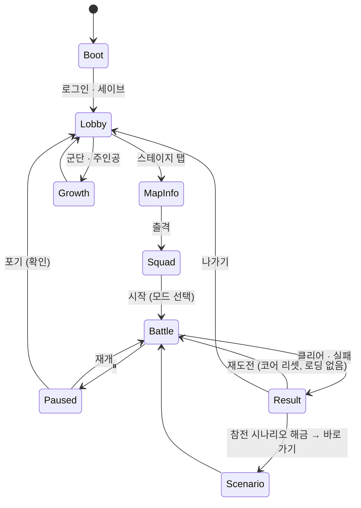

# 06. HUD · UX 설계 — ARMY OF ONE (가칭)

> 대상: 전투 HUD, 로비 6화면, 낙인 시스템 창, 화면 전이, 결과 팝업, 온보딩 안내. 플랫폼은 모바일 Landscape(16:9~21:9), 한 손 엄지 조작 기준. UI 프레임워크는 UI Toolkit(10 TDD §5.4).
> 상태: 초안 v0.1 · 작성일: 2026-11-03 · 선행: [00 §6.1](00_컨셉_제안서.md), [02 GDD §11](02_게임기획서_GDD.md), [04](04_시나리오_챕터_스테이지.md), [08](08_난이도_시뮬레이션_결과.md)

---

## 1. UX 원칙

| 원칙 | 규칙 |
| :--- | :--- |
| P5 선명한 정보 | 보이지 않는 위험은 없다: 경로 · 사거리 · 저지 수 · 쿨 · SP가 전부 화면에 있다. 적 종류는 색 · 크기 · 머리 위 아이콘 3초 안에 구분 |
| 명일방주 문법 | 드래그 소집 → 스와이프 방향, 탭 → 귀환 · 스킬, 좌상 일시정지 · 배속, 우측 DP, 하단 카드 바. 경험자는 설명 없이 플레이 |
| 주인공은 다르다 | 주인공 카드는 하단 바 **왼쪽에 분리**된 큰 카드. 재배치 · 기세 · 넉다운 · 권능은 주인공 카드와 우측 권능 버튼에만 표시 |
| 한 손 | 자주 쓰는 조작(소집 · 재배치 · 권능)은 양 엄지 도달 범위(하단 양 끝 + 우측). 드물게 쓰는 조작(일시정지 · 설정)은 상단 |
| 실수 비용 최소 | 드래그 중 시간 0.2×, 배치 가능 타일 강조, 사거리 미리보기, 방향 확정 전 취소 가능. 재배치는 탭-탭(쿨 중엔 카드가 흔들림) |
| 시스템 창 = 세계관 | 레벨업 · 해금 · 조건은 전부 [낙인] 창. 건조한 격식체, 파란 테두리, 타자 효과 없음(속도) |
| 접근성 | 색각: 아군 난색 + 아이콘, 적 한색 + 아이콘(색만으로 구분하지 않음). 글자 최소 24px(1080p 기준), 터치 타깃 ≥ 64px, 배속 · 일시정지 상시 |

---

## 2. 전투 HUD

### 2.1 레이아웃 (1920×1080 기준, Safe Area 안)
```
┌──────────────────────────────────────────────────────────────────────────────┐
│ ⏸ 1×/2×  [스테이지 1-4]            ♥ 5    적 12/34     웨이브 ▮▮▮▯        ⚙ │  상단 바 h=72
│                                                                                │
│                                                                      ┌──────┐ │
│                                                                      │  DP  │ │  DP 패널 160×96
│                       13×8 타일 전장 (카메라 고정)                     │  24  │ │
│                                                                      │ 3/6  │ │  배치 3/6
│                                                                      └──────┘ │
│                                                                      ┌──────┐ │
│                                                                      │ 권능 │ │  권능 버튼 Ø160
│                                                                      │ SP링 │ │
│ ┌────────┐ ┌────┬────┬────┬────┬────┬────┬────┬────┐                 └──────┘ │
│ │ 주인공 │ │ 1  │ 2  │ 3  │ 4  │ 5  │ 6  │ 7  │ 8  │   ← 카드 바 h=168       │
│ │ 쿨 링  │ │코스트│    │    │    │    │    │    │    │                           │
│ └────────┘ └────┴────┴────┴────┴────┴────┴────┴────┘                           │
└──────────────────────────────────────────────────────────────────────────────┘
```
| 영역 | 크기 · 위치 | 내용 |
| :--- | :--- | :--- |
| 상단 바 | 높이 72, 반투명 | 좌: 일시정지 · 배속(1×/2× 토글). 중: 생명 하트, 적 카운터 "처치/총수", 웨이브 진행 바(스폰 비율). 우: 설정(음량 · 포기) |
| DP 패널 | 우측 중앙, 160×96 | 큰 숫자 DP(정수), 아래 "배치 3/6". DP 증가 시 +N 플로팅(주인공 처치는 금색, 자연 회복은 표시 안 함) |
| 권능 버튼 | 우측 하단, 지름 160 | SP 링(20/25/30), 충전 완료 시 발광 + 진동 1회. 방향형(일섬)은 누른 채 스와이프 → 전장에 5칸 화살표 미리보기 |
| 주인공 카드 | 하단 좌, 168×168 | 초상, HP 바, **재배치 쿨 링**(8s), 기세 스택 점 10개, 넉다운 시 카운트다운 숫자. 탭 → 재배치 모드 |
| 카드 바 | 하단 중앙, 카드 8 × 120×168 | 초상 · 클래스 아이콘 · 코스트(현재 배율 반영) · SP 바. 상태: 소집 가능(밝음) / DP 부족(코스트 붉게) / 재소집 대기(회색 + 초 카운트) / 전장에 있음(축소 + 위치 점) |
| 전장 오버레이 | — | 출현 지점 붉은 균열, 방어 지점 파란 결계, 봉인 타일 보라 문양(주인공 금지 아이콘), 통로 타일 점선, 고지대 측면 색 |

### 2.2 소집 흐름
1. 카드 드래그 시작 → 코어 시간 0.2×, 소집 가능 타일 강조(지상 초록 / 고지대 파랑, 봉인은 군단원만 초록), 커서에 유닛 실루엣 + 사거리 미리보기.
2. 타일 위에서 손을 떼면 **방향 선택 모드**: 4방향 화살표 + 사거리 미리보기가 방향에 따라 회전. 스와이프 120px로 확정, 중앙에서 떼면 취소.
3. 확정 → DP 차감 애니(DP 패널에서 카드로 숫자 날아감) → 낙인 원 → 유닛 등장(0.5s).
- DP 부족 카드는 드래그 자체가 안 되고 코스트가 붉게 깜빡인다.

### 2.3 재배치(주인공) 흐름
1. 주인공 카드 또는 전장의 주인공 탭 → **이동 가능 타일 전부 강조**(지상, 봉인 제외, 점유 제외). 다른 입력은 취소.
2. 타일 탭 → 0.4s 낙인 이동(출발 타일 검은 원 수축, 도착 타일 솟아오름) → 쿨 링 8s 시작.
3. 쿨 중 카드 탭 → 카드 흔들림 + 남은 초 표시. 넉다운 중 탭 → 카운트다운 강조.
- 시뮬(08)에서 재배치가 스테이지당 0~3회라 조작 빈도는 낮다. 대신 **타이밍**이 중요하므로 쿨 종료 0.3s 전 카드에 미세 발광을 준다.

### 2.4 유닛 탭 패널(전장)
- 전장의 군단원 탭 → 유닛 위에 미니 패널: HP, 스킬 버튼(SP 링, 충전 시 발광), 귀환 버튼(환급 DP 표시). 다른 곳 탭으로 닫힘. 일시정지 중에도 가능.
- 주인공 탭은 재배치 모드(§2.3)로 들어가며 패널은 권능 버튼이 대신한다.

### 2.5 피드백
| 사건 | 표시 |
| :--- | :--- |
| 적 누수 | 방어 지점 붉게 점멸 + 생명 하트 1개 깨짐 + 짧은 진동. 보스 누수는 즉시 실패 연출 |
| 넉다운 | 주인공 카드 붉은 테두리 + 10초 카운트, 전장의 주인공 무릎 꿇음, 화면 가장자리 붉은 비네트 1s |
| 군단원 이탈 | 카드가 회색으로 뒤집히며 "재소집 140s", 전장에 낙인 원 소멸 |
| 엘리트 · 보스 등장 | 상단 중앙 2초 배너(이름 + 능력 아이콘), 보스는 체력 바 상단 고정 |
| 권능 가능 | 버튼 발광 + 주인공 머리 위 문양 |
| 숨은 조건 | 전투 중엔 표시하지 않음. 결과 창에서 "조건 달성 → [낙인]" |

### 2.6 적 식별 규칙 (P5)
| 요소 | 규칙 |
| :--- | :--- |
| 색 | 챕터 테마색 베이스(1장 녹색 · 2장 회백 · 3장 흑적 · 4장 적갈 · 5장 금회). 아군은 난색 + 클래스 색 띠 |
| 크기 | 일반 1.0 · 엘리트 1.15 + 붉은 장식 · 보스 1.5~2.0 |
| 머리 위 아이콘 | 원거리 🏹 · 마법 ✦ · 은신(저지 전 반투명 + 👁) · 비행(그림자 + 날개) · 돌진 ⚡ · 부활 ↻ · 엘리트 ! |
| 체력 바 | 피해를 받은 적만 표시(가독성). 보스는 상단 고정 |

---

## 3. 로비 6화면

### 3.1 공통 규격
- 상단: 재화(골드 · 젬 · 명성) + 주인공 등급 뱃지 + 레벨. 좌측 세로 탭 6개(게이트 지도 · 군단 · 주인공 · 수련 · 기록 · 상점). 우측 상단 설정 · 우편.
- 배경: Synty 도시 한 블록 디오라마(카메라 고정, 시간대별 조명 3종). 화면 전이 0.25s 크로스페이드, 뒤로 가기 = 안드로이드 백 버튼 지원.

### 3.2 화면별
| 화면 | 구성 | 핵심 상호작용 |
| :--- | :--- | :--- |
| 게이트 지도 | 서진시 지도 위 챕터 노드(1~5) → 챕터 진입 시 스테이지 8 + 참전 시나리오 + 숨은 합류 슬롯(?로 표시, 조건 공개 후 힌트). 자원 게이트 · 무한 게이트 · 도전 탭 | 스테이지 탭 → **맵 정보 패널**: 격자 축소판(경로 · 출현 · 방어 · 고지대 · 봉인), 적 목록(능력치 · 능력 아이콘), 배치 제한 · 초기 DP · 권장 레벨, 보상, [일반/도전/연습] → 편성 확인 → 출격 |
| 군단 | 좌: 편성 프리셋 4 + 슬롯 8(드래그로 교체). 우: 보유 목록(클래스 필터, 희귀도 정렬). 군단원 탭 → 성장 화면(레벨 · 각성 · 스킬 랭크 · 잠재 · 유대 · 참전 시나리오 회상) | "권장 편성" 버튼: 선택한 스테이지의 적 구성(비행 · 마법 · 고DEF)에 맞춰 클래스 균형 자동 제안 — 08 §8.7의 초보 격차 대응 |
| 주인공 | 좌: 전신(등급별 코트), 레벨 · XP 바. 중: 스탯 5종 슬라이더(+/−, 무료 리셋). 우: 스킬 트리 3갈래(18노드, 권능 장착 슬롯). 하단: 장비 3슬롯 | 스탯 변경 시 실효 ATK · HP · 쿨이 즉시 갱신(09 시트 수식) |
| 수련 | 일일 수련 3 · 주간 과제 · 자원 게이트(요일 · 남은 횟수) · 협회 의뢰(파견 슬롯 3, 타이머) | 의뢰 수거 → 보상 팝업 |
| 기록 | 회상(지난 이벤트 참전 시나리오), 아카이브(군단원 파일 · 대사, 유대 해금), 전투 기록(★ · 자동 지휘 저장 여부) | 자동 지휘 삭제 · 재생 |
| 상점 | 낙인 패스 → 스킨(주인공 · 군단원) → 편의(소탕권 · 자원 게이트 추가 입장 · 의뢰 단축) → 젬 순서. 명성 상점은 별도 탭 | 젬은 성장 재화를 사지 못한다. 자동 지휘 가속 · 전투 안 상품은 없다([11 BM](11_비즈니스_모델_BM.md) §4 · §8) |

---

## 4. 낙인 시스템 창

| 항목 | 규격 |
| :--- | :--- |
| 모양 | 화면 중앙 상단, 폭 720, 파란 테두리 2px, 반투명 검정, 좌측에 낙인 문양. 제목 없음, 본문만 |
| 문체 | 격식체, 1~3줄, 숫자 강조(금색). 예: 「[낙인] Lv.12 → 능력치가 재계산되었습니다. 스탯 포인트 +3.」 |
| 종류 | 레벨업 · 등급 승급 · 합류(참전 · 숨은) · 조건 달성 · 새 기능 해금 · 스토리 메시지(1-3 등) |
| 표시 시점 | 전투 중에는 띄우지 않는다(결과 창 또는 로비 진입 시 큐에서 순서대로). 전투 중 필수 안내는 튜토리얼 말풍선이 맡는다 |
| 조작 | 탭으로 닫힘, 자동 닫힘 4s, 누적은 상단 아이콘 배지 |

---

## 5. 화면 전이 · 결과 팝업



### 5.1 결과 팝업
| 영역 | 클리어 | 실패 |
| :--- | :--- | :--- |
| 상단 | ★ 애니(1 → 2 → 3, 조건: 무손실 · 넉다운 0 표시) | "작전 실패" + 원인 1줄(누수 N / 보스 도달) |
| 중단 | 보상(XP 바 상승 애니, 골드 · 재료 · 첫 클리어 젬), 지표 3개(누수 · 넉다운 · 주인공 처치 비율) | 지표 + "어디서 샜는가": 레인별 누수 수(08 leak_report와 동일 집계) + 추천 1줄("아래 경로에 저지가 없었습니다") |
| 하단 | [다시] [다음 스테이지] [나가기], ★3이면 [자동 지휘 저장] 토글 | [다시] [편성 바꾸기] [나가기] |
| 낙인 큐 | 레벨업 · 조건 달성 · 참전 해금을 순서대로 표시, 해금은 [바로 가기] 버튼 | — |

- 실패 시 비용이 없으므로(이성 없음) [다시]를 가장 크게, 기본 포커스로 둔다. 시뮬(08)에서 초보의 실패가 1-4 · 1-7 · 2~5장 다수에 몰리므로 "어디서 샜는가"가 핵심 학습 장치다.

---

## 6. 온보딩 안내 (튜토리얼 말풍선)

| 스테이지 | 안내 (키 = StageDef.script.key) | 형식 |
| :-: | :--- | :--- |
| 1-1 | `deploy_drag_direction`: "카드를 길 위로 끌어다 놓고, 적이 오는 쪽으로 밀어 방향을 정하세요" · `block_and_highground`: "고지대의 사수는 길을 막지 않고 쏩니다" | 시간 정지 + 손가락 애니, 완료까지 다음 입력 차단 |
| 1-2 | `auto_skill` · `retreat_and_resummon`: "HP가 낮은 아군은 귀환시키고 70초 뒤 다시 부르세요" | 정지 + 하이라이트 |
| 1-3 | `hero_relocate`: "주인공을 탭하고 다른 길을 탭하세요 — 8초마다 한 번" (웨이브마다 화살표 반복, 08 F6) · `momentum_and_ranged_enemy` | 정지 1회, 이후 화살표만 |
| 1-4 | `manual_skill` · `two_routes_hero_cannot_hold_both`: "한 길은 군단이 막아야 합니다" | 정지 |
| 1-5 | `sniper_on_highground_covers_both_lanes` · `charger_enemy_first_hit_x2` | 말풍선만 |
| 1-6 | `ult_sp_from_all_kills`: "군단의 처치도 권능을 채웁니다" | 정지 1회 |
| 1-7 | `crossing_route` · 결과 창 `hidden_join_hint_reveal` | 말풍선 · 결과 창 |
| 1-8 | `boss_sealed_tiles_hero_cannot_enter` | 정지 |
| 2-1 | 고DEF 적 → "주인공과 술사가 유리합니다" | 말풍선 |
| 2-3 | 마법 원거리 → "고지대 군단원을 노립니다. 치유를 두세요" | 말풍선 |
| 3-2 | 은신 → "저지하기 전엔 사격으로 맞출 수 없습니다" | 말풍선 |
| 4-1 | 비행 → "비행 경로는 저지할 수 없습니다. 사수를 두세요" + 권장 편성 제안 | 정지 1회 |
| 5-2 | 봉인 → "주인공이 설 수 없는 길입니다" | 말풍선 |

- 2~5장 안내는 08 §8.6 "초보 클리어 < 50%" 스테이지의 원인(비행 · 은신 · 마법 · 봉인)에 대응한다. 설정에서 전체 끔.

---

## 7. 접근성 · 로컬라이즈
- 폰트: Pretendard(한) / Inter(영), TMP 동적 아틀라스, 최소 24px.
- 색각 모드: 적 · 아군 패턴 오버레이(빗금 · 점) 옵션.
- 진동 · 화면 흔들림 끄기. 좌우 반전 레이아웃(왼손) 옵션: 카드 바와 권능 버튼 위치 교환.
- 텍스트 키는 04 §1 규칙(`ch1.s3.line01`), UI 키는 `ui.battle.dp` 식.

---

## 8. 미결
| # | 미결 | 결정 시점 |
| :-: | :--- | :--- |
| U11 | 재배치 모드에서 "이동 가능 타일 전부 강조"가 13×8에서 과한지(거리 제한 U1과 연동) | 그레이박스 |
| U12 | 권능 방향 스와이프 vs 자동 방향(가장 많은 적 방향) | 그레이박스 |
| U13 | 결과 창 "어디서 샜는가"의 노출 수준(초보만 / 전원) | 플레이테스트 |
