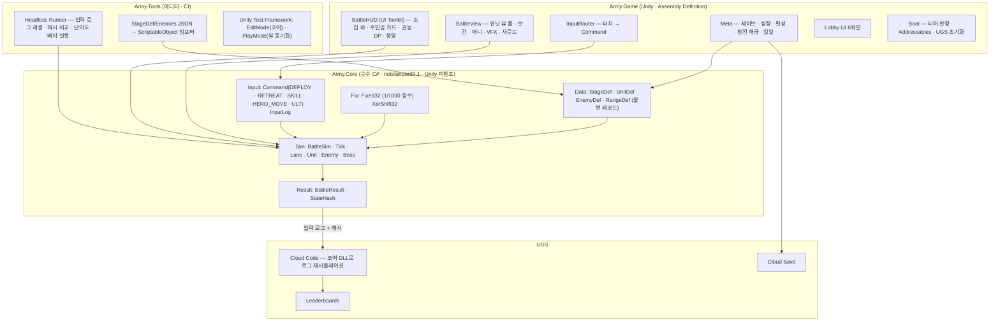

# 10. 기술 설계 문서 (TDD) — ARMY OF ONE (가칭)

> 대상: Unity 개발 착수. 00~09 문서의 설계를 **어떤 구조 · 예산 · 규약으로 구현할지** 정한다. 성능 기준은 이전 프로젝트(RUN BEANIE)와 같은 **2021년 중급 폰 60fps · 보급형 30fps**다. 결정론 전투 코어는 Unity 의존성 없는 순수 C# 어셈블리로 분리하며, 파이썬 시뮬레이터(07 · 08)의 등가 모델이 아니라 **실제 게임 규칙의 원본**이 된다.
> 상태: 초안 v0.1 · 작성일: 2026-11-03 · 선행: [02 GDD](02_게임기획서_GDD.md) §9, [03 다이어그램](03_게임_흐름_구조_다이어그램.md) 13, [09 시트](09_데이터_밸런스_시트.md)
> 제약: 이 세션 환경에는 Unity · dotnet이 없다. 코어 어셈블리의 스캐폴딩(§12)은 로컬에서 `dotnet test`로 검증해야 한다.

---

## 1. 플랫폼 · 엔진 · 대상 기기

| 항목 | 결정 | 근거 |
| :--- | :--- | :--- |
| Unity | **6000.0 LTS (Unity 6)**, URP 17 | Android 16KB 페이지 · 최신 iOS SDK, Render Graph · GPU Resident Drawer. 2022.3 LTS 후퇴 가능하도록 Render Graph 직접 작성 금지(셰이더 그래프만) |
| 렌더 파이프라인 | URP Forward, Directional 1 + 그림자 1캐스케이드(Mid), 셀 셰이딩 2톤 + 아웃라인 1종 | 저사양 대역폭, Synty SIMPLE 아틀라스 공용 머티리얼 |
| 스크립팅 | IL2CPP, ARM64, .NET Standard 2.1, Incremental GC | |
| 필수 패키지 | Addressables 2.x, Input System 1.x, UI Toolkit(런타임), TextMeshPro, Shader Graph, Newtonsoft JSON, Unity Test Framework | Cinemachine 미사용(고정 카메라 1클래스). AI Navigation 미사용(경로는 데이터) |
| 서비스 | UGS Authentication(익명) · Cloud Save · Leaderboards · Cloud Code · Remote Config · Analytics, Unity IAP, LevelPlay | 00 §7, 03 다이어그램 13. 자체 서버 없음 |
| 최소 OS | Android 8.0(API 26) ARM64 · GLES 3.1 + Vulkan 화이트리스트, iOS 15 Metal | |
| 화면 | Landscape 고정, 16:9~21:9, Safe Area | 13×8 전장이 16:9에 좌우 1타일 여백 |

### 1.1 대상 기기 티어
| 티어 | 대표 기기 | 목표 | 설정 |
| :--- | :--- | :--- | :--- |
| Low | Galaxy A32 4G, A21s, Redmi Note 9 | **30fps 고정** | 렌더 스케일 0.7, 그림자 OFF(블롭 데칼), 포스트 없음, 동시 적 상한 20 |
| Mid (기준) | Galaxy A52, S20 FE, iPhone 11, SE 2020 | **60fps** | 스케일 0.85, 그림자 1캐스케이드 1024, LUT |
| High | S21+, iPhone 12/13 | 60fps 네이티브 | 스케일 1.0, 블룸(저해상도) |

---

## 2. 성능 예산

### 2.1 프레임 예산 (Mid 16.6ms / Low 33ms)
전투 최악 상황 = **동시 유닛 60**(적 50 + 아군 9) + 투사체 30 + VFX 20.

| 항목 | Mid(ms) | Low(ms) | 비고 |
| :--- | :-: | :-: | :--- |
| 결정론 코어 틱(30Hz, 프레임당 0~2틱) | 1.5 | 2.5 | 순수 C#, 할당 0. 2배속은 프레임당 2틱 |
| 뷰 동기화(틱 → 트랜스폼 보간, 상태 → 애니 파라미터) | 0.8 | 1.2 | 60 유닛 |
| 애니메이션(Animator 60) | 2.0 | 3.0 | Culling Based on Renderers, 적 애니 4클립 |
| 입력 · HUD(UI Toolkit) | 0.6 | 1.0 | 바인딩은 틱 이벤트 기반, 매 프레임 재구성 금지 |
| VFX · 오디오 트리거 | 0.8 | 1.3 | 풀링 |
| 렌더 CPU | 4.0 | 6.0 | SRP Batcher, GPU Resident Drawer(Mid 이상) |
| GPU | ≤ 9 | ≤ 16 | |
| GC Alloc | 0 B/프레임 | 0 B | 소집 · 결과 팝업에서만 허용 |

### 2.2 렌더 예산
| 항목 | Low | Mid | High |
| :--- | :-: | :-: | :-: |
| Draw calls | ≤ 150 | ≤ 220 | ≤ 300 |
| 삼각형 | ≤ 120k | ≤ 220k | ≤ 350k |
| 머티리얼 | Synty 아틀라스 1 + 셀 셰이드 1 + 데칼 2 + UI | 동일 | 동일 |
| 텍스처 메모리 | ≤ 120 MB | ≤ 180 MB | ≤ 250 MB |

### 2.3 메모리 · 로딩
- 앱 다운로드 ≤ 150 MB(1장 + 로비). 2~5장 환경 · 적 · 군단원은 Addressables 그룹(챕터 단위 ≤ 40 MB)으로 스토어 에셋 배달.
- 전투 씬 로딩 ≤ 3s(Mid), 재시작은 씬 리로드 없이 코어 상태 초기화(≤ 0.3s).

---

## 3. 아키텍처



### 3.1 어셈블리 분리 규칙
| 어셈블리 | 참조 | 금지 |
| :--- | :--- | :--- |
| `Army.Core` | 없음(BCL만) | UnityEngine, float 기반 게임 규칙, DateTime, 랜덤 |
| `Army.Game` | Army.Core, Unity 패키지 | 코어 상태 직접 변경(반드시 Command 경유) |
| `Army.Tools` | Army.Core, UnityEditor | 런타임 포함 금지 |
| `Army.Core.Tests` | Army.Core, NUnit | |

코어는 **입력(StageDef · 편성 스냅샷 · 시드 · Command 열)만으로 결과가 결정**되어야 한다. Cloud Code(Node)에서는 코어를 직접 실행할 수 없으므로, 검증용 코어는 **.NET 콘솔(Headless Runner)을 Cloud Code C# 모듈**로 배포한다(UGS Cloud Code C# 모듈 지원).

---

## 4. 결정론 전투 코어

### 4.1 수치 표현
| 항목 | 표현 | 이유 |
| :--- | :--- | :--- |
| 위치 · 속도 · 시간 | `Fixed32`(int, 1/1000 단위) | iOS · Android · 서버에서 동일 결과. float 누적 금지 |
| HP · 대미지 · DP · SP | int (DP · SP는 ×10) | GDD §9.1 |
| 백분율 | 정수 나눗셈, 순서 고정 `(a * pct) / 100` | 반올림 규칙 명시: 내림 |
| 난수 | `XorShift32(seed)` 1개, 사용처 치명타 · 드랍만 | 시드 = StageDef.seed ^ 편성 해시 |
| 처리 순서 | 입력 → 스폰 → 이동 → 저지 → 공격(유닛 ID 오름차순) → 만료 → 사망 → 자원 → 승패 | GDD §9.1과 동일. 컬렉션 순회 순서는 ID 정렬 |

### 4.2 틱 루프
```
Tick(cmds):
  ApplyCommands(cmds)            // 이 틱의 입력. 검증 실패 명령은 무시 + 로그
  SpawnWaves()                   // t ≥ wave.t
  MoveEnemies()                  // Fixed32, 가속 타일, 광폭화, 선회
  ResolveBlocking()              // 포스트 통과 시 빈 슬롯이면 정지
  Attacks()                      // 아군(ID순) → 적(ID순). 연속 DPS가 아니라 간격 카운터(정수 틱)
  ExpireEffects()                // 스킬 · 기절 · 둔화 · 무적
  Deaths()                       // 이탈 · 넉다운 · 처치 보상(DP · SP · 기세)
  Resources()                    // DP 회복(틱당 0.7/30 ×10 = 정수 누적), SP 자연 회복, 쿨
  CheckEnd()                     // 생명 0 / 적 소진 / 보스 도달
  tick++
```
- 틱 = 1/30 s. 2배속은 프레임당 2틱, 일시정지는 틱 중단(입력은 큐에 쌓여 재개 틱에 적용).
- 공격 간격은 "다음 공격 틱"(int)로 관리한다. 파이썬 등가 모델의 연속 DPS 근사와의 차이(과잉 피해, 이산 타격)는 08 §7의 낙관성 원인이며, 코어 완성 후 헤드리스 러너로 파이썬 결과와 비교해 보정한다.

### 4.3 데이터 모델 (코어 불변 레코드)
| 타입 | 필드 | 출처 |
| :--- | :--- | :--- |
| `StageDef` | id, chapter, grid(13×8 byte), lives, initialDp, dpRegen, deployLimit, heroDefault, sealed[], routes[], routesAir[], waves[], scale, npcUnits[], boss, script[], seed | `unity/Data/Stages/*.json` |
| `UnitDef` | id, class, rarity, hp, atk, def, res, block, cost, redeploy, interval, range, dmgType, skill | params.yaml → `UnitDefs.json`(09 §10 절차에 추가) |
| `EnemyDef` | id, kind, hp, atk, def, res, speed, weight, flying, abilities, interval | `Enemies.json` |
| `HeroDef` | base, levelGrowth, statEffects, tree, ult | params.yaml |
| `SquadSnapshot` | heroLevel, stats, tree, ultId, gear, units[(id, level, awaken, rank, potential)] | 세이브에서 |
| `Command` | tick, type, unit, x, y, dir | 입력 라우터 · 리플레이 |
| `BattleResult` | cleared, stars, lives, knockdowns, leaks, kills, heroKills, dpSpent, hash, conditions(숨은 합류) | |

### 4.4 상태 해시
- 매 틱 종료 시 `FNV-1a 64`로 (tick, dp, sp, lives, 각 유닛 hp/pos/state, 각 적 hp/p/state)를 순서대로 섞는다. 결과 해시 + **10초마다의 체크포인트 해시 열**을 BattleResult에 담는다 → 서버 재시뮬레이션이 "어느 틱에서 갈라졌는지"를 짚을 수 있다.

### 4.5 입력 로그 · 리플레이
- GDD §9.2 포맷. 자동 지휘 = 같은 StageDef 버전 · 같은 SquadSnapshot(레벨 이상)으로 로그 재생. 코어 버전(`coreVersion`)과 StageDef 버전이 다르면 재생 거부.
- 리플레이 테스트: 1장 8스테이지 × 정책 3(파이썬 정책을 포팅한 봇) × 시드 5 = 120 로그를 저장소에 고정하고, CI에서 재생 해시가 일치하는지 검사한다.

---

## 5. Unity 레이어

### 5.1 씬 구성
| 씬 | 내용 | 로딩 |
| :--- | :--- | :--- |
| `Boot` | 티어 판정, Addressables 카탈로그, UGS 익명 로그인, 세이브 로드 | 앱 시작 1회 |
| `Lobby` | 6화면(UI Toolkit) + 디오라마(가벼운 3D 1블록) | 상주 |
| `Battle` | 전장 그리드 · 유닛 풀 · HUD · 카메라 | 게이트 입장 시 Additive, 재시작은 코어 리셋 |

### 5.2 전투 뷰 동기화
- 코어는 프레임과 독립. `BattleView.LateUpdate`에서 `sim.Tick` 결과를 읽어 유닛 뷰에 **보간**(이전 틱 → 현재 틱 위치를 프레임 시간으로 보간). 적 50 + 아군 9의 뷰는 풀에서 꺼내 쓴다.
- 이벤트(스폰 · 처치 · 스킬 · 넉다운 · 소집 등장 · 재배치)는 코어가 틱 이벤트 큐로 내보내고 뷰가 VFX · 사운드로 소비한다. 뷰는 코어 상태를 바꾸지 않는다.
- 애니메이션: Synty 리깅 + Mixamo 리타겟. 아군 6클립(대기 · 공격 2 · 피격 · 넉다운 · 등장), 적 4클립(걷기 · 공격 · 피격 · 사망). 보스는 +페이즈 전환 · 광폭화.

### 5.3 입력
- Input System, 터치 1점. 드래그 임계 12px. 소집 드래그 중 코어 시간 배속 0.2(코어에 `TimeScale` 명령이 아니라 뷰가 틱 호출 빈도를 줄인다 — 결정론 영향 없음).
- 모든 조작은 `Command`로 변환되어 **다음 틱에 적용**된다(입력 지연 ≤ 33ms).

### 5.4 HUD (UI Toolkit)
- 06 문서의 레이아웃. 코어 상태 → HUD 바인딩은 틱 이벤트 기반, 숫자 변경 시에만 갱신. 카드 8 + 주인공 카드는 미리 만든 템플릿 인스턴스.

### 5.5 카메라
- 고정 피치 55° / 요 20°, FOV 30, 스테이지별 프레이밍 데이터(StageDef에 `camera` 확장). 줌 · 회전 없음. 21:9는 좌우 여백 확대.

---

## 6. 데이터 파이프라인

```
params.yaml ─┐                                   ┌─ ScriptableObject(UnitDefs · HeroDef · Rules) ─┐
Enemies.json ─┼─ tools/export_core_data.py ──► unity/Data/*.json ──► Army.Tools 임포터 ─┤                                               ├─ Addressables(챕터 그룹)
gen_*_stagedefs.py ─ unity/Data/Stages/*.json ───────────────────────────────────────┘─ StageDefAsset ──────────────────────────────┘
```
| 단계 | 도구 | 검증 |
| :--- | :--- | :--- |
| 저작 | 파이썬 생성기(스크립트가 원본, U10 결정: **스크립트 저작 유지**, 에디터 저작 도구는 시즌 2) | `stagedef_check.py` |
| 내보내기 | `export_core_data.py`(신규): params.yaml → `UnitDefs.json` · `HeroDef.json` · `Rules.json` | 스키마 버전 필드 |
| 임포트 | `Army.Tools.DataImporter`: JSON → SO, 변경 감지 시 자동 | 임포트 후 코어로 1틱 로드 테스트 |
| 배포 | Addressables 그룹: `core-data`(전부, 앱 포함), `env-ch{n}`, `units-ch{n}` | 카탈로그 버전 = 데이터 버전 |
| 핫픽스 | Remote Config로 `Rules` 일부(DP 회복 · 처치 DP · 챕터 배율)만 덮어씀 | 코어 버전 호환 범위 명시 |

---

## 7. 세이브 · 서비스

| 항목 | 설계 |
| :--- | :--- |
| 세이브 | 로컬 JSON(AES, 기기 키) + Cloud Save 동기화(버전 · 타임스탬프 충돌 시 최신 우선, 수동 복구 UI). 스키마 버전 마이그레이션 함수 |
| 오프라인 | 메인 · 참전 · 자원 게이트 전부 오프라인 가능. 랭킹 · 이벤트 · 상점만 온라인 |
| 랭킹 검증 | 무한 게이트 제출 = 입력 로그 + 해시 + 체크포인트 해시. Cloud Code C# 모듈이 코어로 재시뮬레이션해 일치 시에만 Leaderboards 기록(D14) |
| 치트 대응 | 코어 밖(뷰 · HUD)에는 판정 로직 없음. 세이브 서명. 비정상 해시 · 틱 수는 거부 + Analytics 이벤트 |
| 분석 | Analytics 이벤트: 스테이지 결과(★ · 누수 · 넉다운 · 재배치 · 권능 · DP 소비 · 주인공 처치 비율 · 소요 시간) — 08 문서의 지표와 1:1 (정책 A · B 보정용) |

---

## 8. 품질 자동 판정 · 설정
- 부팅 시 SoC · RAM · 해상도로 티어 추정 → 첫 전투 60프레임 평균 프레임 시간으로 1단계 내림 또는 올림. 설정에서 수동.
- 저사양 전환 항목: 렌더 스케일, 그림자, 포스트, 동시 적 뷰 상한(20 — 초과 적은 코어엔 있으나 뷰는 간이 메시), VFX 밀도.

---

## 9. 테스트 · CI

| 종류 | 내용 | 실행 |
| :--- | :--- | :--- |
| 코어 단위(NUnit, Unity 불필요) | 대미지 공식 · 저지 · DP · 환급 · 재소집 배율 · 넉다운 · 권능 · 보스 페이즈 · 봉인 · 광폭화 | `dotnet test` (CI 매 커밋) |
| 결정론 | 같은 입력 → 같은 해시(플랫폼 3종), 리플레이 120 로그 해시 고정 | CI + 기기 랩 야간 |
| 데이터 | `stagedef_check.py`, 임포터 라운드트립, 스키마 버전 | CI |
| 밸런스 회귀 | 헤드리스 러너로 봇 3종 × 40스테이지 × 100런 → 08 목표 곡선 대비 편차 ±10%p 초과 시 실패 | 주간 |
| PlayMode | 뷰 동기화(틱 ↔ 트랜스폼), HUD 바인딩, 입력 → Command | CI(에디터) |
| 성능 | Profile Analyzer 마커 예산(§2.1) 초과 시 경고, 기기 랩 6대 | 주간 |

CI: GitHub Actions — `dotnet test`(코어) · 파이썬 검증(생성기 · 검증기 · 시뮬 sanity) · Unity 라이선스 러너(EditMode · PlayMode · Android/iOS 빌드).

---

## 10. 규약
- 네임스페이스 `Army.Core.*` · `Army.Game.*` · `Army.Tools.*`. 코어는 `public sealed` 레코드 + 순수 함수 위주, 할당 없는 루프(배열 풀).
- 모든 수치 상수는 `Rules` 데이터에서만. 코드 리터럴 금지(단위 변환 제외).
- 로그 · 분석 이벤트 이름은 `snake_case`, 데이터 키는 09 시트와 동일.
- 커밋: 데이터 변경은 생성기 + 출력물 + 시트를 한 커밋에.

---

## 11. 마일스톤 (Unity 착수 후)

| 주 | 목표 | 산출물 |
| :-: | :--- | :--- |
| 1~2 | `Army.Core` 스캐폴딩 + 1장 규칙 + 단위 테스트, 헤드리스 러너로 파이썬 시뮬과 1-1~1-3 결과 비교 | 코어 DLL, 테스트 60+, 비교 리포트 |
| 3~4 | 그레이박스: 13×8 전장, 주인공 재배치, 소집 드래그, HUD 최소, 1-1~1-3 | D1 · D8 검증(00 §12) |
| 5~6 | 뷰 동기화 완성, Synty 유닛 10종, VFX · 사운드 최소, 1장 8스테이지 + 보스 | 1장 플레이어블 |
| 7~8 | 로비 6화면, 세이브, 성장, 참전 시나리오 3편 | VS(00 §10) |
| 9~10 | UGS(익명 · 세이브 · 랭킹 · Cloud Code 검증), 티어 자동 판정, 성능 예산 달성 | 내부 테스트 빌드 |

---

## 12. 코어 스캐폴딩 (`core/` 디렉터리, 컴파일 미검증)
`core/Army.Core/`에 netstandard2.1 프로젝트, `core/Army.Core.Tests/`에 NUnit 테스트의 **출발점**을 둔다(§12는 이 세션에서 dotnet을 쓸 수 없어 컴파일하지 않았다 — 로컬에서 `dotnet test core`로 먼저 확인). 포함: `Fixed32`, `XorShift32`, `StageDef`/`EnemyDef`/`UnitDef` 레코드와 JSON 로더, `Command`/`InputLog`, `BattleSim`의 틱 루프 골격(이동 · 저지 · 공격 · 자원 · 승패), `StateHash`, 테스트(고정소수점 · 난수 재현 · 1-1 로드 · 10틱 해시 재현).
